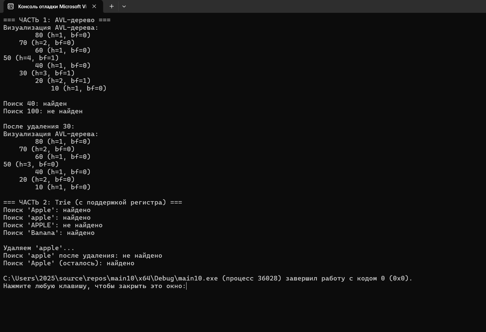

# Лабораторная работа № 10
## AVL-дерево. Префиксное дерево (Trie)

**Выполнил:** _Халмышев Мансур Асланбекович_
**Группа:** __ПИЖ-б-о-25-1__
**Вариант:** 10
**Язык программирования:** C++

---

## 1. Цель работы
1. Реализовать самобалансирующееся AVL-дерево с операциями вставки, удаления и поиска.
2. Освоить механизмы балансировки: малые и большие повороты.
3. Изучить структуру данных «префиксное дерево» (Trie) для эффективного хранения и поиска строк.
4. Реализовать операции вставки, поиска и удаления в Trie.

## 2. Постановка задачи (Вариант 10)
| Часть | Задание |
| :--- | :--- |
| **Часть 1: AVL-дерево** | Вставка, балансировка, поиск, удаление. **Доп. задание:** Визуализация дерева. |
| **Часть 2: Trie** | Вставка, поиск, удаление. **Доп. задание:** Поддержка букв верхнего регистра. |

## 3. Теоретическая часть

### 3.1. AVL-дерево
AVL-дерево — это самобалансирующееся бинарное дерево поиска. Для каждого узла разница высот левого и правого поддеревьев (фактор баланса) не превышает 1. Если баланс нарушается, выполняются повороты (левый, правый, левый-правый, правый-левый). Это гарантирует высоту дерева \(O(\log n)\) и быстродействие операций.

### 3.2. Префиксное дерево (Trie)
Trie — это структура данных для хранения строк. Каждый узел содержит массив указателей на потомков (по количеству символов алфавита) и флаг конца слова. Позволяет искать слова и префиксы за время \(O(L)\), где \(L\) — длина строки, независимо от количества сохраненных слов.

## 4. Листинг программы

```cpp
#include <iostream>
#include <algorithm>
#include <string>
#include <vector>
#include <cctype> // Для работы с символами (toupper, tolower)

using namespace std;

struct AVLNode {
    int key;
    AVLNode* left;
    AVLNode* right;
    int height;

    AVLNode(int k) : key(k), left(nullptr), right(nullptr), height(1) {}
};

class AVLTree {
private:
    AVLNode* root;

    // Получение высоты узла (для пустого узла высота 0)
    int height(AVLNode* node) {
        return node ? node->height : 0;
    }

    // Вычисление фактора баланса (разница высот)
    int balanceFactor(AVLNode* node) {
        return height(node->left) - height(node->right);
    }

    // Обновление высоты узла
    void updateHeight(AVLNode* node) {
        node->height = 1 + max(height(node->left), height(node->right));
    }

    // Правый поворот (Right Rotation)
    AVLNode* rightRotate(AVLNode* y) {
        AVLNode* x = y->left;
        AVLNode* T2 = x->right;

        // Переставляем указатели
        x->right = y;
        y->left = T2;

        // Обновляем высоты
        updateHeight(y);
        updateHeight(x);

        return x; // Новый корень поддерева
    }

    // Левый поворот (Left Rotation)
    AVLNode* leftRotate(AVLNode* x) {
        AVLNode* y = x->right;
        AVLNode* T2 = y->left;

        // Переставляем указатели
        y->left = x;
        x->right = T2;

        // Обновляем высоты
        updateHeight(x);
        updateHeight(y);

        return y; // Новый корень поддерева
    }

    // Балансировка узла (вызывается после вставки или удаления)
    AVLNode* balance(AVLNode* node) {
        if (node == nullptr) return nullptr;

        updateHeight(node);
        int bf = balanceFactor(node);

        // Левое поддерево выше
        if (bf > 1) {
            // Если левый потомок имеет отрицательный баланс — левый-правый поворот
            if (balanceFactor(node->left) < 0) {
                node->left = leftRotate(node->left);
            }
            // Иначе — просто правый поворот
            return rightRotate(node);
        }
        // Правое поддерево выше
        else if (bf < -1) {
            // Если правый потомок имеет положительный баланс — правый-левый поворот
            if (balanceFactor(node->right) > 0) {
                node->right = rightRotate(node->right);
            }
            // Иначе — просто левый поворот
            return leftRotate(node);
        }

        return node; // Баланс в норме
    }

    // Рекурсивная вставка
    AVLNode* insert(AVLNode* node, int key) {
        if (node == nullptr) return new AVLNode(key);

        if (key < node->key) {
            node->left = insert(node->left, key);
        }
        else if (key > node->key) {
            node->right = insert(node->right, key);
        }
        else {
            return node; // Дубликаты не вставляем
        }

        return balance(node); // Балансируем после вставки
    }

    // Поиск узла
    AVLNode* search(AVLNode* node, int key) {
        if (node == nullptr || node->key == key) return node;
        if (key < node->key) return search(node->left, key);
        return search(node->right, key);
    }

    // Поиск минимального узла (для удаления)
    AVLNode* findMin(AVLNode* node) {
        while (node->left != nullptr) node = node->left;
        return node;
    }

    // Рекурсивное удаление
    AVLNode* remove(AVLNode* node, int key) {
        if (node == nullptr) return nullptr;

        if (key < node->key) {
            node->left = remove(node->left, key);
        }
        else if (key > node->key) {
            node->right = remove(node->right, key);
        }
        else {
            // Нашли узел для удаления
            if (node->left == nullptr && node->right == nullptr) {
                delete node;
                return nullptr;
            }
            else if (node->left == nullptr) {
                AVLNode* temp = node->right;
                delete node;
                return temp;
            }
            else if (node->right == nullptr) {
                AVLNode* temp = node->left;
                delete node;
                return temp;
            }
            else {
                // Два потомка: заменяем на минимум из правого поддерева
                AVLNode* minNode = findMin(node->right);
                node->key = minNode->key;
                node->right = remove(node->right, minNode->key);
            }
        }
        return balance(node); // Балансируем после удаления
    }

    // Визуализация дерева (повернуто на 90 градусов)
    void printTree(AVLNode* node, int level = 0) {
        if (node == nullptr) return;
        printTree(node->right, level + 1);
        for (int i = 0; i < level; i++) cout << "    ";
        cout << node->key << " (h=" << node->height << ", bf=" << balanceFactor(node) << ")" << endl;
        printTree(node->left, level + 1);
    }

    // Удаление всего дерева
    void destroy(AVLNode* node) {
        if (node == nullptr) return;
        destroy(node->left);
        destroy(node->right);
        delete node;
    }

public:
    AVLTree() : root(nullptr) {}
    ~AVLTree() { destroy(root); }

    void insert(int key) { root = insert(root, key); }
    bool search(int key) { return search(root, key) != nullptr; }
    void remove(int key) { root = remove(root, key); }

    // Публичный метод для визуализации
    void print() {
        cout << "Визуализация AVL-дерева:" << endl;
        printTree(root);
        cout << endl;
    }
};

class Trie {
private:
    struct TrieNode {
        TrieNode* children[52]; // 26 строчных (a-z) + 26 заглавных (A-Z)
        bool isEndOfWord;

        TrieNode() : isEndOfWord(false) {
            for (int i = 0; i < 52; i++) {
                children[i] = nullptr;
            }
        }
    };

    TrieNode* root;

    // Функция для получения индекса в массиве children
    // Строчные буквы: 0-25, Заглавные: 26-51
    int getIndex(char ch) {
        if (ch >= 'a' && ch <= 'z') return ch - 'a';
        if (ch >= 'A' && ch <= 'Z') return (ch - 'A') + 26;
        return -1; // Не буква
    }

    // Рекурсивное удаление всех узлов
    void destroy(TrieNode* node) {
        if (node == nullptr) return;
        for (int i = 0; i < 52; i++) {
            destroy(node->children[i]);
        }
        delete node;
    }

    // Вспомогательная функция для удаления слова
    bool removeHelper(TrieNode* node, const string& word, int depth) {
        if (node == nullptr) return false;

        // Если дошли до конца слова
        if (depth == word.length()) {
            if (!node->isEndOfWord) return false; // Слова не было
            node->isEndOfWord = false;            // Помечаем, что слово удалено

            // Если у узла нет потомков, его можно удалить
            for (int i = 0; i < 52; i++) {
                if (node->children[i] != nullptr) return false;
            }
            return true; // Узел можно удалить
        }

        int index = getIndex(word[depth]);
        if (index == -1) return false;

        bool shouldDeleteChild = removeHelper(node->children[index], word, depth + 1);

        if (shouldDeleteChild) {
            delete node->children[index];
            node->children[index] = nullptr;

            // Проверяем, можно ли удалить и текущий узел
            if (!node->isEndOfWord) {
                for (int i = 0; i < 52; i++) {
                    if (node->children[i] != nullptr) return false;
                }
                return true;
            }
        }
        return false;
    }

public:
    Trie() { root = new TrieNode(); }
    ~Trie() { destroy(root); }

    // Вставка слова (с поддержкой регистра)
    void insert(const string& word) {
        TrieNode* current = root;
        for (char ch : word) {
            int index = getIndex(ch);
            if (index == -1) continue; // Пропускаем не-буквы
            if (current->children[index] == nullptr) {
                current->children[index] = new TrieNode();
            }
            current = current->children[index];
        }
        current->isEndOfWord = true;
    }

    // Поиск слова
    bool search(const string& word) {
        TrieNode* current = root;
        for (char ch : word) {
            int index = getIndex(ch);
            if (index == -1) return false;
            if (current->children[index] == nullptr) return false;
            current = current->children[index];
        }
        return current->isEndOfWord;
    }

    // Удаление слова
    void remove(const string& word) {
        removeHelper(root, word, 0);
    }
};


int main() {
    setlocale(LC_ALL, "ru");

    // --- ЧАСТЬ 1: AVL-дерево ---
    cout << "=== ЧАСТЬ 1: AVL-дерево ===" << endl;
    AVLTree avl;
    avl.insert(50);
    avl.insert(30);
    avl.insert(70);
    avl.insert(20);
    avl.insert(40);
    avl.insert(60);
    avl.insert(80);
    avl.insert(10); // Вызовет дисбаланс и правый поворот

    avl.print();

    cout << "Поиск 40: " << (avl.search(40) ? "найден" : "не найден") << endl;
    cout << "Поиск 100: " << (avl.search(100) ? "найден" : "не найден") << endl;

    avl.remove(30);
    cout << "\nПосле удаления 30:" << endl;
    avl.print();


    // --- ЧАСТЬ 2: Trie ---
    cout << "=== ЧАСТЬ 2: Trie (с поддержкой регистра) ===" << endl;
    Trie trie;
    trie.insert("Apple");
    trie.insert("apple");
    trie.insert("Banana");
    trie.insert("Car");
    trie.insert("cat");

    cout << "Поиск 'Apple': " << (trie.search("Apple") ? "найдено" : "не найдено") << endl;
    cout << "Поиск 'apple': " << (trie.search("apple") ? "найдено" : "не найдено") << endl;
    cout << "Поиск 'APPLE': " << (trie.search("APPLE") ? "найдено" : "не найдено") << endl; // Не должно найтись
    cout << "Поиск 'Banana': " << (trie.search("Banana") ? "найдено" : "не найдено") << endl;

    cout << "\nУдаляем 'apple'..." << endl;
    trie.remove("apple");
    cout << "Поиск 'apple' после удаления: " << (trie.search("apple") ? "найдено" : "не найдено") << endl;
    cout << "Поиск 'Apple' (осталось): " << (trie.search("Apple") ? "найдено" : "не найдено") << endl;

    return 0;
}
```
### 5. Результаты работы программы


## 6. Анализ сложности операций

В ходе работы были проанализированы основные операции для AVL-дерева и префиксного дерева (Trie). Сложность операций в AVL-дереве зависит от его высоты \(h\), а в Trie — от длины строки \(L\).

| Структура | Операция | Средняя сложность | Худшая сложность | Обоснование |
| :--- | :--- | :--- | :--- | :--- |
| **AVL-дерево** | Вставка | \(O(\log n)\) | \(O(\log n)\) | Дерево всегда сбалансировано (высота \(\log n\)), а балансировка (повороты) занимает \(O(1)\). |
| **AVL-дерево** | Поиск | \(O(\log n)\) | \(O(\log n)\) | Спуск по дереву от корня до листа занимает время, пропорциональное высоте. |
| **AVL-дерево** | Удаление | \(O(\log n)\) | \(O(\log n)\) | Поиск узла + возможный поиск минимума + балансировка на обратном пути. |
| **Trie** | Вставка | \(O(L)\) | \(O(L)\) | Проход по каждому символу строки (L — длина). |
| **Trie** | Поиск | \(O(L)\) | \(O(L)\) | Проход по каждому символу строки. |
| **Trie** | Удаление | \(O(L)\) | \(O(L)\) | Проход по строке + очистка узлов, если они больше не нужны. |

## 7. Сравнительная таблица BST vs AVL vs Trie

| Характеристика | BST (обычное дерево) | AVL (самобалансирующееся) | Trie (префиксное дерево) |
| :--- | :--- | :--- | :--- |
| **Поиск (средний)** | \(O(\log n)\) | \(O(\log n)\) | \(O(L)\) — длина строки |
| **Вставка (средний)** | \(O(\log n)\) | \(O(\log n)\) | \(O(L)\) |
| **Удаление (средний)** | \(O(\log n)\) | \(O(\log n)\) | \(O(L)\) |
| **Худший случай** | \(O(n)\) (при вырождении) | \(O(\log n)\) | \(O(L)\) |
| **Память** | \(O(n)\) | \(O(n)\) | \(O(\text{алфавит} \times \text{длина})\) |
| **Строковые операции** | Медленные (сравнение) | Медленные | Быстрые |
| **Автодополнение** | Нет | Нет | Да |

## 8. Ответы на контрольные вопросы

**1. Что такое AVL-дерево? В чём его отличие от обычного BST?**
AVL-дерево — это самобалансирующееся бинарное дерево поиска. Отличие от обычного BST в том, что AVL-дерево автоматически поддерживает свою высоту в пределах \(O(\log n)\) с помощью поворотов, тогда как обычный BST может выродиться в связный список с высотой \(O(n)\).

**2. Что такое фактор баланса? Как он вычисляется?**
Фактор баланса (balance factor) — это разница между высотами левого и правого поддеревьев узла. Вычисляется по формуле: \(BF = height(left) - height(right)\). В AVL-дереве допустимыми значениями являются -1, 0 и 1.

**3. Какие существуют типы поворотов в AVL-дереве?**
Существует четыре типа поворотов:
1. Правый (Right Rotation) — LL-случай.
2. Левый (Left Rotation) — RR-случай.
3. Левый-правый (Left-Right Rotation) — LR-случай.
4. Правый-левый (Right-Left Rotation) — RL-случай.

**4. Когда применяется правый поворот? Левый поворот?**
*   **Правый поворот:** Когда фактор баланса узла \(> 1\) (левое поддерево выше) и фактор баланса левого потомка \(\ge 0\).
*   **Левый поворот:** Когда фактор баланса узла \(< -1\) (правое поддерево выше) и фактор баланса правого потомка \(\le 0\).

**5. Когда применяется левый-правый поворот? Правый-левый?**
*   **Левый-правый:** Когда фактор баланса \(> 1\), а фактор баланса левого потомка \(< 0\). Сначала делают левый поворот для левого потомка, затем правый для узла.
*   **Правый-левый:** Когда фактор баланса \(< -1\), а фактор баланса правого потомка \(> 0\). Сначала делают правый поворот для правого потомка, затем левый для узла.

**6. Какова сложность операций в AVL-дереве?**
Вставка, поиск и удаление в AVL-дереве выполняются за \(O(\log n)\) как в среднем, так и в худшем случае, благодаря тому, что дерево всегда остается сбалансированным.

**7. Почему AVL-дерево называется самобалансирующимся?**
Оно называется самобалансирующимся, потому что после каждой операции вставки или удаления алгоритм автоматически проверяет фактор баланса всех узлов на пути и при необходимости выполняет повороты, восстанавливая баланс без участия пользователя.

**8. Как часто происходит балансировка при вставке?**
Балансировка происходит только тогда, когда после вставки нового узла фактор баланса какого-либо узла становится равным 2 или -2. На практике это случается не на каждом шаге, а только при нарушении инварианта AVL.

**9. Чем AVL-дерево отличается от красно-чёрного дерева?**
AVL-дерево имеет более строгий баланс (разница высот не более 1), что обеспечивает более быстрый поиск. Красно-чёрное дерево имеет менее строгий баланс, но требует меньше поворотов при вставке и удалении, поэтому операции модификации в нем быстрее.

**10. В каких случаях AVL-дерево эффективнее BST?**
AVL-дерево эффективнее обычного BST в случаях, когда данные поступают в отсортированном порядке или близком к нему. В такой ситуации обычный BST вырождается в список и деградирует до \(O(n)\), а AVL-дерево сохраняет \(O(\log n)\).

**11. Что такое Trie (префиксное дерево)? Для решения каких задач оно используется?**
Trie — это древовидная структура данных для хранения строк. Используется для: автодополнения (подсказок при вводе), поиска по префиксу, проверки орфографии, реализации IP-маршрутизации и словарей.

**12. Какова сложность поиска в Trie? От чего она зависит?**
Сложность поиска в Trie составляет \(O(L)\), где \(L\) — длина искомой строки. Она не зависит от количества хранимых в дереве слов, а зависит только от длины ключа.

**13. Какая структура данных эффективнее для строк: Trie или хеш-таблица?**
Для точного поиска строк обе структуры хороши (Trie — \(O(L)\), хеш-таблица — \(O(1)\) в среднем). Однако Trie выигрывает, если требуется поиск по префиксу или автодополнение, так как хеш-таблица не поддерживает такие операции.

**14. Как реализовать автодополнение с помощью Trie?**
Нужно спуститься по дереву до узла, соответствующего введенному префиксу. Затем с помощью обхода в глубину (DFS) собрать все слова, которые находятся в поддереве этого узла (ориентируясь на флаг `isEndOfWord`).

**15. Каковы недостатки Trie? Какой объём памяти он требует?**
Главный недостаток — большой расход памяти. Каждый узел содержит массив указателей на всех возможных потомков (например, 26 для английского алфавита). Если строки длинные, а алфавит большой, это может быть очень затратно по памяти.

## 9. Вывод

В ходе выполнения лабораторной работы я освоил реализацию двух сложных структур данных: самобалансирующегося AVL-дерева и префиксного дерева (Trie).

1. **AVL-дерево:** Я изучил механизмы балансировки (малые и большие повороты), реализовал операции вставки, поиска и удаления. Главное преимущество AVL-дерева — гарантированная сложность \(O(\log n)\) для всех операций даже в худших случаях, что делает его отличным выбором для задач, где важна предсказуемая скорость доступа к данным. Также я реализовал визуализацию дерева в консоли, что позволяет наглядно оценить структуру и баланс узлов.

2. **Префиксное дерево (Trie):** Я реализовал структуру для эффективного хранения и поиска строк. Была добавлена поддержка букв верхнего и нижнего регистра (путем расширения массива потомков до 52 элементов) и операция удаления слов. Trie показал свою эффективность для строковых операций, где сложность зависит только от длины строки \(L\), а не от количества хранимых слов.

Сравнительный анализ показал, что выбор структуры данных зависит от задачи: AVL-дерево идеально для числовых данных и точного поиска, а Trie — для текстовых данных, словарей и систем автодополнения.

### 10. Ссылка на Git-репозиторий
https://github.com/mansurkhalmyshev-tech/cpp-labs.git

