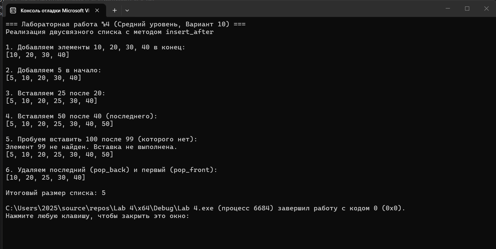

# Лабораторная работа № 4
## Односвязный и двусвязный списки

**Выполнил:** _Халмышев Мансур Асланбекович_
**Группа:** __ПИЖ-б-о-25-1__
**Вариант:** 10 (Средний уровень)
**Язык программирования:** C++

---

## 1. Цель работы
1. Реализовать шаблонный класс двусвязного списка (`DoublyLinkedList`).
2. Освоить операции вставки, удаления и обхода элементов в списках.
3. Научиться правильно управлять памятью при работе со списками (удаление узлов).
4. Реализовать дополнительную функциональность согласно варианту.

## 2. Постановка задачи (Вариант 10)
Реализовать класс двусвязного списка со следующими методами:
*   Базовые операции: `push_back`, `push_front`, `pop_back`, `pop_front`, `print`, `clear`, `size`, `empty`.
*   **Дополнительная функциональность:** реализовать метод `insert_after`, который вставляет новый элемент после заданного значения.

## 3. Теоретическая часть

### 3.1. Двусвязный список
Двусвязный список — это структура данных, состоящая из узлов. В отличие от односвязного списка, каждый узел содержит не только указатель на следующий элемент (`next`), но и указатель на предыдущий (`prev`). Это позволяет эффективно перемещаться по списку в обоих направлениях и удалять элементы за O(1), если у нас есть указатель на удаляемый узел.

### 3.2. Сложность основных операций
| Операция | Сложность | Обоснование |
| :--- | :--- | :--- |
| `push_front`, `push_back` | **O(1)** | Добавление элемента требует только изменения нескольких указателей. |
| `pop_front`, `pop_back` | **O(1)** | Удаление крайних элементов также не требует перебора. |
| `insert_after` | **O(n)** | Требуется пройти по списку от начала до элемента с заданным значением (поиск занимает O(n)), после чего сама вставка выполняется за O(1). |
| `clear` | **O(n)** | Необходимо пройти по всем узлам и освободить память. |

## 4. Листинг программы

```cpp
#include <iostream>     
#include <stdexcept>     

using namespace std;    

// Шаблонный класс двусвязного списка

template <typename T>
class DoublyLinkedList {
private:
    // Внутренняя структура узла 
    struct Node {
        T data;          // Поле для хранения самих данных
        Node* prev;      // Указатель на предыдущий узел
        Node* next;      // Указатель на следующий узел

        // Конструктор узла: при создании принимает значение и инициализирует указатели пустотой
        Node(const T& value) : data(value), prev(nullptr), next(nullptr) {}
    };

    Node* head;          // Указатель на самый первый элемент списка (голова)
    Node* tail;          // Указатель на самый последний элемент списка (хвост)
    int count;           // Счетчик, хранящий текущее количество элементов

public:
    // Конструктор по умолчанию: создает пустой список
    DoublyLinkedList() : head(nullptr), tail(nullptr), count(0) {}

    // Деструктор: вызывается автоматически при удалении объекта, чтобы очистить память
    ~DoublyLinkedList() {
        clear();
    }

    // Добавление элемента в конец списка
    // Сложность: O(1)
    void push_back(const T& value) {
        Node* newNode = new Node(value); // Выделяем память под новый узел

        if (tail == nullptr) {           // Если список был пуст
            head = tail = newNode;       // Новый узел становится и головой, и хвостом
        }
        else {                         // Если в списке уже есть элементы
            tail->next = newNode;        // Старый хвост теперь указывает на новый узел
            newNode->prev = tail;        // Новый узел ссылается назад на старый хвост
            tail = newNode;              // Новый узел официально становится хвостом
        }
        count++;                         // Увеличиваем счетчик элементов
    }

    // Добавление элемента в начало списка
    // Сложность: O(1)
    void push_front(const T& value) {
        Node* newNode = new Node(value); // Выделяем память под новый узел

        if (head == nullptr) {           // Если список был пуст
            head = tail = newNode;       // Новый узел становится и головой, и хвостом
        }
        else {                         // Если в списке уже есть элементы
            newNode->next = head;        // Новый узел указывает вперед на старую голову
            head->prev = newNode;        // Старая голова ссылается назад на новый узел
            head = newNode;              // Новый узел официально становится головой
        }
        count++;

        // Удаление элемента из конца списка
        // Сложность: O(1)
        void pop_back() {
            if (tail == nullptr) throw underflow_error("List is empty"); // Если список пуст, кидаем ошибку

            Node* temp = tail;               // Запоминаем текущий хвост, чтобы потом удалить
            tail = tail->prev;               // Сдвигаем указатель хвоста на предыдущий элемент

            if (tail != nullptr) {           // Если в списке остались элементы
                tail->next = nullptr;        // Обрываем связь нового хвоста со старым
            }
            else {                         // Если удалили последний элемент, и список стал пуст
                head = nullptr;              // Голова тоже должна обнулиться
            }

            delete temp;                     // Освобождаем память удаленного узла
            count--;                         // Уменьшаем счетчик элементов
        }

        // Удаление элемента из начала списка
        // Сложность: O(1)
        void pop_front() {
            if (head == nullptr) throw underflow_error("List is empty"); // Проверка на пустоту

            Node* temp = head;               // Запоминаем текущую голову
            head = head->next;               // Сдвигаем указатель головы на следующий элемент

            if (head != nullptr) {           // Если в списке остались элементы
                head->prev = nullptr;        // Обрываем связь новой головы со старым
            }
            else {                         // Если удалили последний элемент
                tail = nullptr;              // Хвост тоже обнуляется
            }

            delete temp;                     // Удаляем старый первый узел
            count--;                         // Уменьшаем счетчик
        }


        // Сложность: O(n) на поиск узла + O(1) на саму вставку
        void insert_after(const T & target, const T & value) {
            Node* current = head;            // Начинаем поиск с начала списка

            // Ищем узел с заданным значением
            while (current != nullptr) {
                if (current->data == target) { // Если нашли нужное значение
                    Node* newNode = new Node(value); // Создаем новый узел

                    // Если вставляем после последнего элемента (он же хвост)
                    if (current == tail) {
                        push_back(value);    // Просто используем готовый метод добавления в конец
                    }
                    else {
                        // Вставка в середину (перестраиваем 4 указателя)
                        newNode->next = current->next; // Новый узел смотрит на следующего после current
                        newNode->prev = current;       // Новый узел смотрит назад на current
                        current->next->prev = newNode; // Следующий узел смотрит назад на новый узел
                        current->next = newNode;       // Current теперь смотрит вперед на новый узел
                        count++;                       // Увеличиваем счетчик
                    }
                    return;
                }
                current = current->next; // Переходим к следующему узлу, если не нашли
            }

            // Если цикл закончился, а элемент не нашли:
            cout << "Элемент " << target << " не найден. Вставка не выполнена." << endl;
        }

        // Вывод списка в прямом порядке
        void print() const {
            Node* current = head;            // Начинаем с головы
            cout << "[";
            while (current != nullptr) {     // Проходим по всем узлам до конца
                cout << current->data;       // Выводим данные текущего узла
                if (current->next != nullptr) cout << ", "; // Ставим запятую, если это не последний элемент
                current = current->next;     // Переходим к следующему
            }
            cout << "]" << endl;
        }

        // Очистка списка 
        void clear() {
            while (head != nullptr) {        // Пока в списке есть элементы
                Node* temp = head;           // Запоминаем текущую голову
                head = head->next;           // Сдвигаем голову на следующий
                delete temp;                 // Удаляем старую голову
            }
            tail = nullptr;                  // Обнуляем хвост
            count = 0;                       // Сбрасываем счетчик
        }

        // Метод получения размера списка
        int size() const { return count; }   // Возвращает значение счетчика

        // Проверка на пустоту
        bool empty() const { return head == nullptr; } // Если головы нет, значит список пуст
    };

    int main() {
        setlocale(LC_ALL, "ru"); // Включаем поддержку русского языка в консоли

        cout << "=== Лабораторная работа №4 (Средний уровень, Вариант 10) ===" << endl;
        cout << "Реализация двусвязного списка с методом insert_after" << endl << endl;

        DoublyLinkedList<int> list; // Создаем объект списка, хранящий целые числа (int)

        // 1. Заполняем список
        cout << "1. Добавляем элементы 10, 20, 30, 40 в конец:" << endl;
        list.push_back(10);         // Добавляем 10 в конец
        list.push_back(20);         // Добавляем 20 в конец
        list.push_back(30);         // Добавляем 30 в конец
        list.push_back(40);         // Добавляем 40 в конец
        list.print();               // Печатаем список: [10, 20, 30, 40]

        // 2. Демонстрация push_front
        cout << "\n2. Добавляем 5 в начало:" << endl;
        list.push_front(5);         // Добавляем 5 в начало
        list.print();               // Печатаем: [5, 10, 20, 30, 40]

        // 3. Демонстрация insert_after (Вариант 10)
        cout << "\n3. Вставляем 25 после 20:" << endl;
        list.insert_after(20, 25);  // Ищем 20 и вставляем после него 25
        list.print();               // Печатаем: [5, 10, 20, 25, 30, 40]

        // 4. Вставка после последнего элемента
        cout << "\n4. Вставляем 50 после 40 (последнего):" << endl;
        list.insert_after(40, 50);  // Ищем 40 и вставляем после него 50 (сработает ветка с tail)
        list.print();               // Печатаем: [5, 10, 20, 25, 30, 40, 50]

        // 5. Попытка вставить после несуществующего элемента
        cout << "\n5. Пробуем вставить 100 после 99 (которого нет):" << endl;
        list.insert_after(99, 100); // Должно вывести сообщение, что элемент не найден
        list.print();               // Список не меняется

        // 6. Демонстрация удаления
        cout << "\n6. Удаляем последний (pop_back) и первый (pop_front):" << endl;
        list.pop_back();            // Удаляем 50 из конца
        list.pop_front();           // Удаляем 5 из начала
        list.print();               // Печатаем оставшиеся: [10, 20, 25, 30, 40]

        cout << "\nИтоговый размер списка: " << list.size() << endl; // Выводит 5

        return 0; 
    };
};
```
 5. Результаты работы программы
При запуске программа демонстрирует работу всех базовых методов двусвязного списка, а также корректную работу дополнительного метода insert_after, включая обработку случаев вставки в конец списка и поиска несуществующего элемента.



## Ответы на контрольные вопросы 
1. В чём отличие односвязного списка от двусвязного?
В односвязном списке каждый узел хранит только указатель на следующий элемент. В двусвязном — и на следующий, и на предыдущий. Это позволяет двусвязному списку эффективно перемещаться в обоих направлениях, но требует больше памяти под указатели и более аккуратного обновления связей при операциях.

1. Какова сложность удаления элемента из конца двусвязного списка?
O(1). Поскольку у нас есть указатель на хвост (tail), мы можем получить предыдущий элемент за один шаг (tail->prev), обновить его указатель next на nullptr и удалить старый хвост. В односвязном списке эта операция заняла бы O(n), так как пришлось бы бежать от начала до предпоследнего элемента.

1. Зачем нужен count?
Переменная count хранит текущее количество элементов. Без неё для получения размера списка пришлось бы проходить по всем узлам (O(n)). С count метод size() работает за O(1).

1. Как работает метод insert_after?
Сначала выполняется поиск узла с заданным значением (O(n)). Если узел найден, создается новый узел, и указатели перестраиваются так, чтобы новый элемент оказался между найденным узлом и его следующим соседом. Если найденный узел является последним (tail), то вставка сводится к вызову push_back.

1. Почему деструктор вызывает clear()?
Деструктор должен освободить всю выделенную динамическую память. Вызов clear() в деструкторе предотвращает утечки памяти, так как clear() проходит по всем узлам и вызывает delete для каждого из них.

1. Вывод
В ходе лабораторной работы я реализовал шаблонный класс двусвязного списка, освоил операции вставки, удаления и обхода. Также была реализована дополнительная функциональность в виде метода insert_after. Работа со списками требует внимательного отношения к указателям, особенно при удалении и вставке в середину, чтобы не потерять связи между узлами. Двусвязный список оказался удобен для операций с хвостом (удаление за O(1)).


 ### Ссылка на Git-репозиторий
https://github.com/mansurkhalmyshev-tech/Lab4-ACD/blob/main/README.md