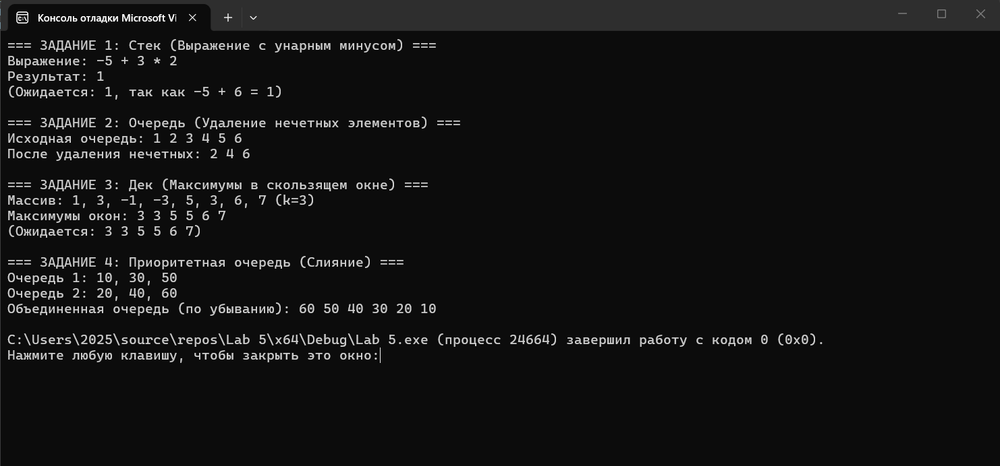

# Лабораторная работа № 5
## Стек, очередь, дек, приоритетная очередь

**Выполнил:** _Халмышев Мансур Асланбекович_
**Группа:** __ПИЖ-б-о-25-1__
**Вариант:** 10
**Язык программирования:** C++

---

## 1. Цель работы
1. Реализовать основные линейные структуры данных: стек, очередь, дек и приоритетную очередь.
2. Освоить принципы LIFO (стек) и FIFO (очередь).
3. Научиться реализовывать эти структуры на основе динамического массива и связного списка.
4. Изучить применение стека для решения задач (вычисление выражений).
5. Реализовать приоритетную очередь на основе кучи (heap).

## 2. Постановка задачи (Вариант 10)

| Структура | Задание |
| :--- | :--- |
| **Стек** | Вычислить значение выражения с унарным минусом (-5 + 3) |
| **Очередь** | Удалить все нечётные элементы из очереди |
| **Дек** | Скользящее окно: найти максимумы во всех подмассивах длины k |
| **Приоритетная очередь** | Реализовать операцию merge (слияние двух приоритетных очередей) |

## 3. Листинг программы

```cpp
#include <iostream>
#include <vector>
#include <string>
#include <stdexcept>
#include <cctype>

using namespace std;

template <typename T>
class Stack {
private:
    T* data;         // Указатель на массив для хранения элементов
    int topIndex;    // Индекс верхнего элемента (вершины)
    int capacity;    // Текущая вместимость массива

    // Приватный метод для расширения массива при переполнении
    void resize() {
        capacity *= 2; // Увеличиваем емкость в 2 раза
        T* newData = new T[capacity]; // Выделяем новую память
        for (int i = 0; i <= topIndex; i++) {
            newData[i] = data[i]; // Копируем старые элементы в новый массив
        }
        delete[] data;   // Удаляем старый массив
        data = newData;  // Перенаправляем указатель на новый массив
    }

public:
    // Конструктор
    Stack(int initialCapacity = 10) : capacity(initialCapacity), topIndex(-1) {
        data = new T[capacity]; // Выделяем начальную память
    }

    // Деструктор
    ~Stack() {
        delete[] data; // Освобождаем память
    }

    // Добавление элемента на вершину
    void push(const T& value) {
        if (topIndex >= capacity - 1) resize(); // Если места нет, расширяемся
        data[++topIndex] = value; // Увеличиваем индекс и записываем значение
    }

    // Удаление и возврат верхнего элемента
    T pop() {
        if (isEmpty()) throw underflow_error("Stack is empty"); // Проверка на пустоту
        return data[topIndex--]; // Возвращаем элемент и уменьшаем индекс
    }

    // Просмотр верхнего элемента без удаления
    T top() const {
        if (isEmpty()) throw underflow_error("Stack is empty");
        return data[topIndex];
    }

    // Проверка на пустоту
    bool isEmpty() const { return topIndex == -1; }

    // Получение текущего размера
    int size() const { return topIndex + 1; }
};

// Функция для вычисления выражения с унарным минусом
double evaluateExpression(const string& expr) {
    Stack<double> values; // Стек для чисел
    Stack<char> ops;      // Стек для операторов

    // Лямбда-функция для определения приоритета оператора
    auto precedence = [](char op) {
        if (op == '+' || op == '-') return 1; // Сложение и вычитание - низкий приоритет
        if (op == '*' || op == '/') return 2; // Умножение и деление - высокий
        return 0;
        };

    // Лямбда-функция для выполнения операции над двумя числами
    auto applyOp = [&]() {
        if (values.size() < 2) throw runtime_error("Not enough operands"); // Ошибка, если чисел меньше 2
        double b = values.pop(); // Берем второе число
        double a = values.pop(); // Берем первое число
        char op = ops.pop();     // Берем оператор
        switch (op) {
        case '+': values.push(a + b); break;
        case '-': values.push(a - b); break;
        case '*': values.push(a * b); break;
        case '/':
            if (b == 0) throw runtime_error("Division by zero"); // Защита от деления на 0
            values.push(a / b);
            break;
        }
        };

    // Проходим по каждому символу строки
    for (size_t i = 0; i < expr.length(); i++) {
        char ch = expr[i];
        if (isspace(ch)) continue; // Пропускаем пробелы

        // Если символ - цифра или точка (парсим число)
        if (isdigit(ch) || ch == '.') {
            double val = 0;
            while (i < expr.length() && (isdigit(expr[i]) || expr[i] == '.')) {
                if (expr[i] == '.') { // Обработка дробной части
                    double frac = 0.1;
                    i++;
                    while (i < expr.length() && isdigit(expr[i])) {
                        val += (expr[i] - '0') * frac;
                        frac *= 0.1;
                        i++;
                    }
                    break;
                }
                val = val * 10 + (expr[i] - '0'); // Сборка целой части
                i++;
            }
            i--; // Откат индекса, так как внешний цикл его увеличит
            values.push(val); // Кладем число в стек
        }
        // Обработка минуса (унарного или бинарного)
        else if (ch == '-') {
            // Если минус стоит в начале или после другого оператора - он унарный
            if (i == 0 || expr[i - 1] == '(' || expr[i - 1] == '+' || expr[i - 1] == '-' || expr[i - 1] == '*' || expr[i - 1] == '/') {
                values.push(0); // Унарный минус = (0 - число)
                ops.push('-');
            }
            else { // Бинарный минус
                while (!ops.isEmpty() && precedence(ops.top()) >= precedence('-')) {
                    applyOp(); // Выполняем предыдущие операции с большим приоритетом
                }
                ops.push('-');
            }
        }
        // Обработка остальных операторов
        else if (ch == '+' || ch == '*' || ch == '/') {
            while (!ops.isEmpty() && precedence(ops.top()) >= precedence(ch)) {
                applyOp();
            }
            ops.push(ch);
        }
        // Обработка скобок
        else if (ch == '(') {
            ops.push(ch);
        }
        else if (ch == ')') {
            while (!ops.isEmpty() && ops.top() != '(') {
                applyOp(); // Выполняем всё внутри скобок
            }
            if (!ops.isEmpty()) ops.pop(); // Удаляем открывающую скобку
        }
    }

    // Выполняем оставшиеся операции в стеке
    while (!ops.isEmpty()) {
        applyOp();
    }

    return values.top(); // Результат находится на вершине стека чисел
}

template <typename T>
class Queue {
private:
    T* data;         // Массив для хранения
    int frontIndex;  // Индекс начала очереди
    int rearIndex;   // Индекс конца очереди
    int count;       // Текущее количество элементов
    int capacity;    // Вместимость

    // Расширение кольцевого буфера
    void resize() {
        int newCapacity = capacity * 2;
        T* newData = new T[newCapacity];
        for (int i = 0; i < count; i++) {
            newData[i] = data[(frontIndex + i) % capacity]; // "Выпрямляем" кольцо
        }
        delete[] data;
        data = newData;
        frontIndex = 0;  // Сбрасываем начало в 0
        rearIndex = count; // Конец указывает на следующий свободный индекс
        capacity = newCapacity;
    }

public:
    Queue(int initialCapacity = 10) : capacity(initialCapacity), frontIndex(0), rearIndex(0), count(0) {
        data = new T[capacity];
    }

    ~Queue() { delete[] data; }

    // Добавление в конец
    void enqueue(const T& value) {
        if (count >= capacity) resize(); // Расширяемся при необходимости
        data[rearIndex] = value;         // Записываем значение
        rearIndex = (rearIndex + 1) % capacity; // Сдвигаем конец по кругу
        count++;
    }

    // Удаление из начала
    T dequeue() {
        if (isEmpty()) throw underflow_error("Queue is empty");
        T value = data[frontIndex];      // Запоминаем значение
        frontIndex = (frontIndex + 1) % capacity; // Сдвигаем начало по кругу
        count--;
        return value;
    }

    // Просмотр первого элемента
    T front() const {
        if (isEmpty()) throw underflow_error("Queue is empty");
        return data[frontIndex];
    }

    bool isEmpty() const { return count == 0; }
    int size() const { return count; }
};

// Функция удаления нечетных элементов
void removeOddElements(Queue<int>& q) {
    int originalSize = q.size(); // Запоминаем исходный размер
    for (int i = 0; i < originalSize; i++) {
        int val = q.dequeue();       // Извлекаем элемент
        if (val % 2 == 0) {          // Если он четный
            q.enqueue(val);          // Возвращаем его в конец очереди
        }                            // Нечетные просто "выбрасываются"
    }
}

template <typename T>
class Deque {
private:
    struct Node {
        T data;
        Node* prev;
        Node* next;
        Node(const T& value) : data(value), prev(nullptr), next(nullptr) {}
    };
    Node* head; // Указатель на начало
    Node* tail; // Указатель на конец
    int count;

public:
    Deque() : head(nullptr), tail(nullptr), count(0) {}

    // Деструктор очищает память
    ~Deque() {
        while (head != nullptr) {
            Node* temp = head;
            head = head->next;
            delete temp;
        }
    }

    // Добавление в конец
    void push_back(const T& value) {
        Node* newNode = new Node(value);
        if (tail == nullptr) { // Если пусто
            head = tail = newNode;
        }
        else {
            tail->next = newNode;
            newNode->prev = tail;
            tail = newNode;
        }
        count++;
    }

    // Добавление в начало
    void push_front(const T& value) {
        Node* newNode = new Node(value);
        if (head == nullptr) {
            head = tail = newNode;
        }
        else {
            newNode->next = head;
            head->prev = newNode;
            head = newNode;
        }
        count++;
    }

    // Удаление из начала
    T pop_front() {
        if (isEmpty()) throw underflow_error("Deque is empty");
        Node* temp = head;
        T value = temp->data;
        head = head->next;
        if (head != nullptr) head->prev = nullptr;
        else tail = nullptr;
        delete temp;
        count--;
        return value;
    }

    // Удаление с конца
    T pop_back() {
        if (isEmpty()) throw underflow_error("Deque is empty");
        Node* temp = tail;
        T value = temp->data;
        tail = tail->prev;
        if (tail != nullptr) tail->next = nullptr;
        else head = nullptr;
        delete temp;
        count--;
        return value;
    }

    T front() const {
        if (isEmpty()) throw underflow_error("Deque is empty");
        return head->data;
    }

    T back() const {
        if (isEmpty()) throw underflow_error("Deque is empty");
        return tail->data;
    }

    bool isEmpty() const { return count == 0; }
    int size() const { return count; }
};

// Функция поиска максимумов в скользящем окне
vector<int> slidingWindowMax(const vector<int>& nums, int k) {
    vector<int> result; // Сюда будем сохранять ответы
    Deque<int> dq;      // Дек для хранения ИНДЕКСОВ элементов

    for (int i = 0; i < nums.size(); i++) {
        // 1. Удаляем индексы, которые вышли за пределы окна (левее i-k)
        if (!dq.isEmpty() && dq.front() <= i - k) {
            dq.pop_front();
        }

        // 2. Удаляем с конца все элементы, которые меньше текущего (они не станут максимумами)
        while (!dq.isEmpty() && nums[dq.back()] <= nums[i]) {
            dq.pop_back();
        }

        // 3. Добавляем текущий индекс
        dq.push_back(i);

        // 4. Если окно уже "набралось" (достигло размера k), записываем максимум
        if (i >= k - 1) {
            result.push_back(nums[dq.front()]); // В начале дека всегда максимальный элемент
        }
    }
    return result;
}

template <typename T>
class PriorityQueue {
private:
    T* heap;      // Массив для двоичной кучи
    int count;    // Количество элементов
    int capacity; // Вместимость

    // Расширение массива
    void resize() {
        int newCapacity = capacity * 2;
        T* newHeap = new T[newCapacity];
        for (int i = 0; i < count; i++) newHeap[i] = heap[i];
        delete[] heap;
        heap = newHeap;
        capacity = newCapacity;
    }

    // Просеивание вверх (при добавлении)
    void heapifyUp(int index) {
        while (index > 0) {
            int parent = (index - 1) / 2; // Формула родителя
            if (heap[index] > heap[parent]) { // Если потомок больше родителя - меняем
                swap(heap[index], heap[parent]);
                index = parent;
            }
            else {
                break; // Если порядок верный - останавливаемся
            }
        }
    }

    // Просеивание вниз (при извлечении)
    void heapifyDown(int index) {
        while (true) {
            int left = 2 * index + 1;  // Формула левого потомка
            int right = 2 * index + 2; // Формула правого потомка
            int largest = index;       // Ищем максимальный среди отца и детей

            if (left < count && heap[left] > heap[largest]) largest = left;
            if (right < count && heap[right] > heap[largest]) largest = right;

            if (largest == index) break; // Если родитель больше всех - куча в порядке

            swap(heap[index], heap[largest]); // Меняем местами
            index = largest; // Спускаемся дальше
        }
    }

public:
    PriorityQueue(int initialCapacity = 10) : capacity(initialCapacity), count(0) {
        heap = new T[capacity];
    }

    ~PriorityQueue() { delete[] heap; }

    // Добавление элемента
    void push(const T& value) {
        if (count >= capacity) resize();
        heap[count] = value; // Ставим в конец
        heapifyUp(count);    // Поднимаем на правильное место
        count++;
    }

    // Извлечение максимального элемента
    T pop() {
        if (isEmpty()) throw underflow_error("PriorityQueue is empty");
        T maxValue = heap[0];        // Максимум всегда в корне (индекс 0)
        heap[0] = heap[count - 1];   // На место корня ставим последний элемент
        count--;
        heapifyDown(0);              // Опускаем его на правильное место
        return maxValue;
    }

    T top() const {
        if (isEmpty()) throw underflow_error("PriorityQueue is empty");
        return heap[0]; // Просто смотрим на корень
    }

    bool isEmpty() const { return count == 0; }
    int size() const { return count; }
};

// Функция слияния двух приоритетных очередей
PriorityQueue<int> mergePQ(PriorityQueue<int>& pq1, PriorityQueue<int>& pq2) {
    PriorityQueue<int> result; // Создаем новую очередь

    // Перекладываем элементы из первой очереди
    while (!pq1.isEmpty()) {
        result.push(pq1.pop());
    }
    // Перекладываем элементы из второй
    while (!pq2.isEmpty()) {
        result.push(pq2.pop());
    }

    return result;
}

// Главная функция
int main() { 
    setlocale(LC_ALL, "ru"); 

    cout << "=== ЗАДАНИЕ 1: Стек (Выражение с унарным минусом) ===" << endl; // Выводим заголовок задания
    string expr = "-5 + 3 * 2"; // Задаем строку с математическим выражением
    cout << "Выражение: " << expr << endl;
    cout << "Результат: " << evaluateExpression(expr) << endl; // Вызываем функцию вычисления и выводим результат

    cout << "(Ожидается: 1, так как -5 + 6 = 1)" << endl << endl; // Выводим пояснение для проверки и делаем отступ

    cout << "=== ЗАДАНИЕ 2: Очередь (Удаление нечетных элементов) ===" << endl; // Заголовок второго задания
    Queue<int> q; // Создаем объект очереди для хранения целых чисел
    q.enqueue(1); q.enqueue(2); q.enqueue(3); // Добавляем элементы 1, 2, 3 в очередь
    q.enqueue(4); q.enqueue(5); q.enqueue(6); // Добавляем элементы 4, 5, 6 в очередь

    cout << "Исходная очередь: 1 2 3 4 5 6" << endl; // Выводим исходное состояние очереди
    removeOddElements(q); // Вызываем функцию, которая удаляет нечетные элементы и оставляет четные

    cout << "После удаления нечетных: "; // Выводим текст для результата
    while (!q.isEmpty()) { // Цикл работает, пока очередь не опустеет
        cout << q.dequeue() << " "; // Извлекаем элемент из очереди и выводим его
    }
    cout << endl << endl; // Переходим на новую строку и делаем отступ

    cout << "=== ЗАДАНИЕ 3: Дек (Максимумы в скользящем окне) ===" << endl; // Заголовок третьего задания

    vector<int> nums = { 1, 3, -1, -3, 5, 3, 6, 7 }; // Создаем массив (вектор) с числами для анализа
    int k = 3; // Задаем размер скользящего окна
    cout << "Массив: 1, 3, -1, -3, 5, 3, 6, 7 (k=3)" << endl; // Выводим исходный массив и размер окна
    vector<int> maxs = slidingWindowMax(nums, k); // Вызываем функцию поиска максимумов и сохраняем результат в вектор
    cout << "Максимумы окон: "; // Выводим текст для результата

    for (int x : maxs) cout << x << " "; // Проходим по всем найденным максимумам и выводим их
    cout << endl; // Переходим на новую строку
    cout << "(Ожидается: 3 3 5 5 6 7)" << endl << endl; // Выводим ожидаемый ответ для проверки

    cout << "=== ЗАДАНИЕ 4: Приоритетная очередь (Слияние) ===" << endl; // Заголовок четвертого задания
    PriorityQueue<int> pq1, pq2; // Создаем две приоритетные очереди для целых чисел
    pq1.push(10); pq1.push(30); pq1.push(50); // Заполняем первую очередь элементами
    pq2.push(20); pq2.push(40); pq2.push(60); // Заполняем вторую очередь элементами

    cout << "Очередь 1: 10, 30, 50" << endl; // Выводим содержимое первой очереди
    cout << "Очередь 2: 20, 40, 60" << endl; // Выводим содержимое второй очереди

    PriorityQueue<int> merged = mergePQ(pq1, pq2); // Вызываем функцию слияния и сохраняем новую очередь

    cout << "Объединенная очередь (по убыванию): "; // Выводим текст для результата
    while (!merged.isEmpty()) { // Пока объединенная очередь не пуста
        cout << merged.pop() << " "; // Извлекаем максимальный элемент и выводим его
    }
    cout << endl;
    return 0;
    
     
    
  
   
```
 Результаты работы программы


### Анализ сложности операций

| Структура | Операция | Сложность | Обоснование |
| :--- | :--- | :--- | :--- |
| **Стек** | push, pop, top | **O(1)** | Все операции выполняются с вершиной массива. |
| **Очередь** | enqueue, dequeue | **O(1)** | Используется кольцевой буфер, доступ по индексу за константу. |
| **Дек** | push/pop (front/back) | **O(1)** | Вставка/удаление с концов двусвязного списка. |
| **Приоритетная очередь** | push, pop | **O(log n)** | Требуется просеивание элемента вверх/вниз по куче (высота дерева). |
| **Приоритетная очередь** | top | **O(1)** | Максимум всегда находится в корне кучи (индекс 0). |

### Ответы на контрольные вопросы 
 1. В чём заключается принцип работы стека (LIFO)?
Last In, First Out. Последний добавленный элемент извлекается первым. Аналогия: стопка тарелок.

 2. В чём заключается принцип работы очереди (FIFO)?
First In, First Out. Первый добавленный элемент извлекается первым. Аналогия: очередь в магазине.

 3. Чем дек отличается от обычной очереди?
Дек (Double-Ended Queue) позволяет добавлять и удалять элементы с обоих концов, тогда как обычная очередь — только с одного (в конец добавляем, из начала извлекаем).

 4. Что такое приоритетная очередь? Где она применяется?
Это структура, где каждый элемент имеет приоритет, и первым извлекается элемент с наивысшим приоритетом. Применяется в планировщиках задач ОС, алгоритмах Дейкстры, сжатии данных (Хаффман).

 5. Как реализовать стек на основе динамического массива?
Выделить массив, хранить индекс вершины (topIndex). При push увеличивать индекс и записывать элемент, при pop уменьшать. При переполнении — расширять массив.

 6. Как реализовать очередь на основе кольцевого буфера?
Использовать массив фиксированного размера и два индекса (front, rear). При добавлении rear = (rear + 1) % capacity, при удалении front = (front + 1) % capacity. Это позволяет использовать освободившееся в начале место.

 7. Почему приоритетную очередь обычно реализуют на куче?
Куча (heap) позволяет выполнять вставку и извлечение максимума/минимума за O(log n), а получение экстремума за O(1). Это оптимальный баланс по сравнению с отсортированным массивом (O(n) вставка) или списком (O(n) поиск).

 8. Какова сложность операций push и pop в стеке?
O(1) — операции выполняются с концом массива.

 9. Какова сложность операций enqueue и dequeue в очереди?
O(1) при использовании кольцевого буфера или связного списка.

  10. Какова сложность операций в приоритетной очереди? Почему?
Вставка и извлечение — O(log n), так как нужно "просеять" элемент по высоте двоичной кучи. Получение максимума — O(1), он всегда в корне.

### Вывод
В ходе лабораторной работы я реализовал четыре базовые структуры данных: стек, очередь, дек и приоритетную очередь. Были изучены их принципы работы (LIFO и FIFO). Также я решил прикладные задачи: вычисление математического выражения с унарным минусом (стек), фильтрация данных (очередь), поиск максимумов в скользящем окне (дек) и слияние очередей (приоритетная очередь). Это показало, как выбор правильной структуры данных упрощает решение алгоритмических задач.

 ### Ссылка на Git-репозиторий
https://github.com/mansurkhalmyshev-tech/Lab5-ACD.git

