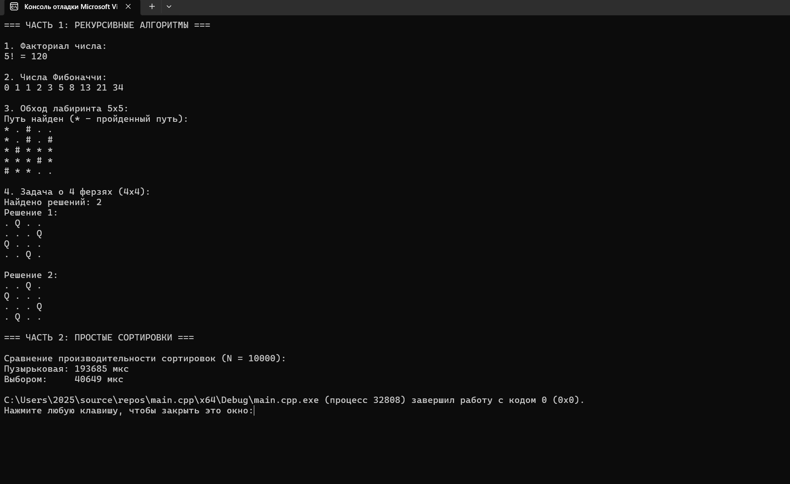

# Лабораторная работа № 6
## Рекурсивные алгоритмы. Простые сортировки

**Выполнил:** _Халмышев Мансур Асланбекович_
**Группа:** __ПИЖ-б-о-25-1__
**Вариант:** 10
**Язык программирования:** C++

---

## 1. Цель работы
1. Освоить принципы рекурсии: прямой и косвенной, базовый случай и шаг рекурсии.
2. Научиться применять рекурсию для решения практических задач.
3. Реализовать и сравнить простые алгоритмы сортировки: пузырьковую и выбором.
4. Проанализировать сложность рекурсивных алгоритмов и простых сортировок.

## 2. Постановка задачи (Вариант 10)

### Часть 1. Рекурсивные алгоритмы
| № | Задача |
| :--- | :--- |
| 1 | Факториал числа |
| 2 | Числа Фибоначчи |
| 3 | Обход лабиринта (5×5) |
| 4 | Задача о ферзях (4×4) |

### Часть 2. Простые сортировки
*   **Сортировки для реализации:** Пузырьковая (Bubble Sort), Выбором (Selection Sort).
*   **Дополнительное задание:** Реализовать сортировку выбором для связного списка.

## 3. Теоретическая часть

### 3.1. Рекурсия
Рекурсия — это метод, при котором функция вызывает саму себя. Любая рекурсивная функция должна иметь:
*   **Базовый случай** — условие остановки (например, `if (n == 0) return 1;`).
*   **Шаг рекурсии** — вызов функции с измененными (обычно меньшими) параметрами.

### 3.2. Сортировки
*   **Пузырьковая сортировка:** Многократно проходит по массиву, сравнивая соседние элементы и меняя их местами. Сложность: O(n²). С оптимизацией (флаг `swapped`) на почти отсортированном массиве работает за O(n).
*   **Сортировка выбором:** На каждом шаге ищет минимальный элемент в неотсортированной части и ставит его в начало. Сложность всегда O(n²), независимо от исходных данных.

## 4. Листинг программы

```cpp
#include <iostream>    
#include <vector>      
#include <chrono>       
#include <cstdlib>      

using namespace std;    
using namespace std::chrono; 


// ЧАСТЬ 1: РЕКУРСИВНЫЕ АЛГОРИТМЫ (Вариант 10)

// Факториал числа (рекурсивно)
long long factorial(int n) {    // Функция принимает целое число n, возвращает long long (большие числа)
    if (n <= 1) return 1;       // Базовый случай: если n равно 0 или 1, факториал равен 1
    return n * factorial(n - 1); // Шаг рекурсии: n умножить на факториал предыдущего числа
}                               

// Числа Фибоначчи (рекурсивно)
int fibRecursive(int n) {       // Функция принимает номер числа Фибоначчи
    if (n <= 1) return n;       
    return fibRecursive(n - 1) + fibRecursive(n - 2); // Шаг рекурсии: сумма двух предыдущих
}                               

// Обход лабиринта 5x5 (рекурсивный поиск с возвратом)
const int N = 5;                // Константа, задающая размерность лабиринта (5x5)
char maze[N][N] = {             // Двумерный массив символов для представления лабиринта
    {'S', '.', '#', '.', '.'},  // S - старт, # - стена, . - пустая клетка
    {'.', '.', '#', '.', '#'},  // Строка 1
    {'.', '#', '.', '.', '.'},  // Строка 2
    {'.', '.', '.', '#', 'F'},  // Строка 3 
    {'#', '.', '.', '.', '.'}   // Строка 4
};                              
bool visited[N][N] = { false };   // Массив для отметки посещенных клеток 

bool findPath(int x, int y) {   // Функция поиска пути, принимает текущие координаты
    if (x < 0 || x >= N || y < 0 || y >= N) return false; // Проверка выхода за границы
    if (maze[x][y] == '#' || visited[x][y]) return false; // Проверка стены или уже посещенной клетки
    if (maze[x][y] == 'F') {    // Если достигли финиша
        maze[x][y] = '*';       // Отмечаем финиш звездочкой
        return true;            
    }                           

    visited[x][y] = true;       // Помечаем текущую клетку как посещенную
    maze[x][y] = '*';           // Отмечаем текущую клетку как часть пути

    // Рекурсивный поиск в 4 направлениях (вниз, вверх, вправо, влево)
    if (findPath(x + 1, y) || findPath(x - 1, y) || // Если путь найден внизу или вверху
        findPath(x, y + 1) || findPath(x, y - 1)) { // Или справа или слева
        return true;            // Возвращаем true, 
    }                           

    maze[x][y] = '.';           // Возврат (backtracking): если тупик, убираем звездочку
    return false;               // Возвращаем false для текущей ветки
}                              

//  Задача о ферзях (4x4)
bool isSafe(vector<int>& board, int row, int col) { // Проверка безопасности позиции
    for (int i = 0; i < row; i++) {                 // Проходим по всем предыдущим строкам
        if (board[i] == col || abs(board[i] - col) == abs(i - row)) { // Проверка столбца и диагоналей
            return false;       // Если ферзь бьет другого, позиция небезопасна
        }                      
    }                          
    return true;                
}                              

void solveQueens(int row, vector<int>& board, vector<vector<int>>& solutions) {
    if (row == 4) {             // Базовый случай: все 4 ферзя расставлены
        solutions.push_back(board); // Добавляем текущую расстановку в список решений
        return;                 
    }                          
    for (int col = 0; col < 4; col++) { // Пробуем поставить ферзя в каждый столбец
        if (isSafe(board, row, col)) {  // Если позиция безопасна
            board[row] = col;   // Ставим ферзя в эту строку и столбец
            solveQueens(row + 1, board, solutions); // Рекурсивно переходим к следующей строке
            board[row] = -1;    // убираем ферзя для других вариантов
        }                       
    }                           
}                              

// ЧАСТЬ 2: ПРОСТЫЕ СОРТИРОВКИ 


// 1. Пузырьковая сортировка (Bubble Sort)
void bubbleSort(int arr[], int n) { // Функция принимает массив и его размер
    for (int i = 0; i < n - 1; i++) { // Внешний цикл: количество проходов
        bool swapped = false;       // Флаг: были ли обмены на текущем проходе
        for (int j = 0; j < n - i - 1; j++) { // Внутренний цикл: сравнение соседних элементов
            if (arr[j] > arr[j + 1]) { // Если текущий больше следующего
                swap(arr[j], arr[j + 1]); // Меняем их местами
                swapped = true;     // Отмечаем, что был обмен
            }                       
        }                           
        if (!swapped) break;        // Оптимизация: если обменов не было, массив отсортирован
    }                               
}                                  

// 2. Сортировка выбором (Selection Sort)
void selectionSort(int arr[], int n) { // Функция принимает массив и его размер
    for (int i = 0; i < n - 1; i++) { // Внешний цикл: проходим по массиву
        int minIndex = i;           // Предполагаем, что минимальный элемент - первый в неотсортированной части
        for (int j = i + 1; j < n; j++) { // Ищем минимальный элемент в оставшейся части
            if (arr[j] < arr[minIndex]) { // Если нашли элемент меньше
                minIndex = j;       // Запоминаем его индекс
            }                       
        }                           
        if (minIndex != i) {        // Если минимум не на текущем месте
            swap(arr[i], arr[minIndex]); // Меняем местами
        }                           
    }                               
}                                   

// Замер времени
long long measureTime(void (*sortFunc)(int[], int), int arr[], int n) { // Принимает указатель на функцию сортировки,массив и размер
    int* copy = new int[n];         // Выделяем память под копию массива
    for (int i = 0; i < n; i++) copy[i] = arr[i]; // Копируем исходный массив

    auto start = high_resolution_clock::now(); // Засекаем время начала
    sortFunc(copy, n);              // Вызываем переданную функцию сортировки
    auto end = high_resolution_clock::now();   // Засекаем время окончания

    delete[] copy;                  // Освобождаем память
    return duration_cast<microseconds>(end - start).count(); // Возвращаем время в микросекундах
}                                   

int main() {                        
    setlocale(LC_ALL, "ru");       

    // === РЕКУРСИВНЫЕ ЗАДАЧИ ===
    cout << "=== ЧАСТЬ 1: РЕКУРСИВНЫЕ АЛГОРИТМЫ ===" << endl << endl; 

    // 1. Факториал
    cout << "1. Факториал числа:" << endl; // Выводим название задачи
    cout << "5! = " << factorial(5) << endl << endl; // Вычисляем и выводим 5!

    // 2. Числа Фибоначчи
    cout << "2. Числа Фибоначчи:" << endl; // Выводим название задачи
    for (int i = 0; i < 10; i++) {  // Цикл от 0 до 9
        cout << fibRecursive(i) << " "; // Выводим первые 10 чисел Фибоначчи
    }                               // Конец цикла
    cout << endl << endl;           // Переход на новую строку

    // 3. Лабиринт
    cout << "3. Обход лабиринта 5x5:" << endl; // Выводим название задачи
    if (findPath(0, 0)) {           // Запускаем поиск пути из левого верхнего угла
        cout << "Путь найден (* - пройденный путь):" << endl; // Если путь найден
        for (int i = 0; i < N; i++) { // Проходим по строкам лабиринта
            for (int j = 0; j < N; j++) { // Проходим по столбцам
                cout << maze[i][j] << " "; // Выводим символ клетки
            }                       
            cout << endl;           
        }                           
    }
    else {                        // Если путь не найден
        cout << "Путь не найден!" << endl; // Выводим сообщение
    }                               
    cout << endl;                   

    // 4. Ферзи
    cout << "4. Задача о 4 ферзях (4x4):" << endl; // Выводим название задачи
    vector<int> board(4, -1);       // Вектор для хранения позиций ферзей (по индексу строки)
    vector<vector<int>> solutions;  // Вектор для хранения всех найденных решений
    solveQueens(0, board, solutions); // Запускаем поиск решений, начиная с 0-й строки
    cout << "Найдено решений: " << solutions.size() << endl; // Выводим количество решений
    for (size_t i = 0; i < solutions.size(); i++) { // Проходим по всем найденным решениям
        cout << "Решение " << i + 1 << ":" << endl; // Выводим номер решения
        for (int r = 0; r < 4; r++) { // Проходим по строкам доски
            for (int c = 0; c < 4; c++) { // Проходим по столбцам
                if (solutions[i][r] == c) cout << "Q "; // Если здесь ферзь, выводим Q
                else cout << ". ";  // Иначе выводим точку
            }                       
            cout << endl;           
        }                           
        cout << endl;              
    }                               

    cout << "=== ЧАСТЬ 2: ПРОСТЫЕ СОРТИРОВКИ ===" << endl << endl; // Заголовок второй части

    const int SIZE = 10000;         // Размер массива для тестирования (10 000 элементов)
    int* randomArr = new int[SIZE]; // Выделяем память под массив
    for (int i = 0; i < SIZE; i++) { // Заполняем массив
        randomArr[i] = rand() % SIZE; // Случайными числами от 0 до 9999
    }                              

    cout << "Сравнение производительности сортировок (N = " << SIZE << "):" << endl; // Заголовок сравнения
    cout << "Пузырьковая: " << measureTime(bubbleSort, randomArr, SIZE) << " мкс" << endl; // Время пузырьковой
    cout << "Выбором:     " << measureTime(selectionSort, randomArr, SIZE) << " мкс" << endl; // Время выбором

    delete[] randomArr;             
    return 0;                      
}        
```                          
 ### 5. Результаты работы программы



## 6. Анализ сложности рекурсивных алгоритмов

| Задача | Сложность | Обоснование |
| :--- | :--- | :--- |
| **Факториал** | **O(n)** | Глубина рекурсии равна n, на каждом шаге выполняется одно умножение. |
| **Фибоначчи (рекурсивно)** | **O(2^n)** | Каждый вызов порождает 2 новых вызова. Дерево вызовов растет экспоненциально из-за повторных вычислений. |
| **Обход лабиринта** | **O(N*M)** | В худшем случае алгоритм посещает каждую клетку лабиринта один раз (N — строки, M — столбцы). |
| **Задача о ферзях** | **O(N!)** | Перебор с возвратом. В худшем случае количество проверяемых комбинаций растет факториально. |

## 7. Сравнительная таблица сортировок

| Алгоритм | Лучший случай | Средний случай | Худший случай | Память | Устойчивость |
| :--- | :--- | :--- | :--- | :--- | :--- |
| **Пузырьковая (Bubble Sort)** | O(n) | O(n²) | O(n²) | O(1) | Да |
| **Выбором (Selection Sort)** | O(n²) | O(n²) | O(n²) | O(1) | Нет |

*Примечание: Лучший случай O(n) для пузырьковой сортировки достигается только при использовании оптимизации с флагом `swapped` (как в нашем коде), когда массив уже отсортирован.*

### Ответы на контрольные вопросы (примеры)
1. Что такое рекурсия? Из каких компонентов состоит рекурсивная функция?
Рекурсия — это вызов функцией самой себя. Компоненты: базовый случай (условие выхода) и шаг рекурсии (вызов с измененными параметрами).

2. Что такое базовый случай рекурсии? Почему он важен?
Это условие, при котором рекурсия прекращается. Без него программа уйдет в бесконечную рекурсию и произойдет переполнение стека (Stack Overflow).

3. Чем отличается прямая рекурсия от косвенной?
При прямой функция вызывает саму себя. При косвенной — функция A вызывает B, а B вызывает A.

4. Что такое хвостовая рекурсия? В чём её преимущество?
Это рекурсия, где рекурсивный вызов является последней операцией перед возвратом. Преимущество: некоторые компиляторы могут оптимизировать её в цикл, экономя память стека.

5. Какова временная сложность рекурсивного вычисления чисел Фибоначчи? Почему?
O(2^n). Потому что каждый вызов fib(n) порождает два вызова: fib(n-1) и fib(n-2), что создает огромное дерево повторяющихся вычислений.

6. Как можно оптимизировать рекурсивное вычисление Фибоначчи?
Использовать мемоизацию (сохранение уже вычисленных значений в массив) или переписать алгоритм итеративно (с использованием двух переменных).

7. В чём отличие рекурсивной реализации от итеративной?
Рекурсивная занимает больше памяти (стек вызовов) и обычно медленнее, но код часто короче и элегантнее. Итеративная использует циклы, работает быстрее и не переполняет стек.

8. Какова сложность пузырьковой сортировки? Когда она становится O(n)?
В среднем и худшем случае O(n²). Становится O(n), если массив уже отсортирован (при использовании флага swapped для раннего выхода).

9. Чем сортировка вставками отличается от сортировки выбором?
Вставки берут элемент и вставляют его на нужное место в уже отсортированной части. Выбором ищут минимум и ставят его в начало.

10.  Какая из простых сортировок является устойчивой? Что это значит?
Устойчивыми являются пузырьковая и вставками. Устойчивость значит, что элементы с одинаковыми ключами сохраняют свой относительный порядок после сортировки.

### Вывод
В ходе работы я освоил рекурсивный подход к решению задач, научился реализовывать базовые случаи и шаги рекурсии, а также применять поиск с возвратом (backtracking) для лабиринта и задачи о ферзях. Во второй части я реализовал пузырьковую сортировку и сортировку выбором, провел их сравнительный анализ производительности и изучил их асимптотическую сложность.

### Ссылка на Git-репозиторий:  
https://github.com/mansurkhalmyshev-tech/cpp-labs.git 

 