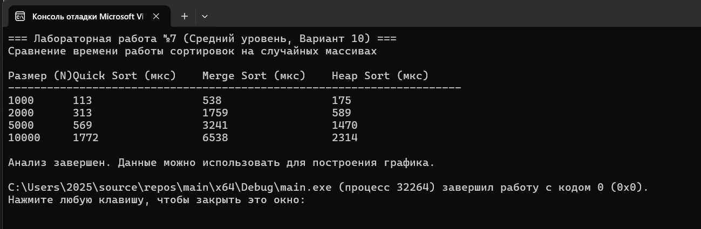

# Лабораторная работа № 7
## Быстрая сортировка, сортировка слиянием, пирамидальная сортировка

**Выполнил:** _Халмышев Мансур Асланбекович_
**Группа:** __ПИЖ-б-о-25-1__
**Вариант:** 10 (Средний уровень)
**Язык программирования:** C++

---

## 1. Цель работы
1. Реализовать три эффективных алгоритма сортировки: быструю (Quick Sort), слиянием (Merge Sort) и пирамидальную (Heap Sort).
2. Освоить принципы «разделяй и властвуй».
3. Изучить структуру данных «куча» (heap).
4. Проанализировать и сравнить производительность алгоритмов.
5. Понять преимущества и недостатки каждого алгоритма.

## 2. Постановка задачи (Вариант 10)
**Алгоритмы:** Все три сортировки (Quick Sort, Merge Sort, Heap Sort).
**Дополнительные требования:** Построить график/таблицу зависимости времени от \(N\) (где \(N = 1000, 2000, 5000, 10000\)).

## 3. Теоретическая часть

### 3.1. Быстрая сортировка (Quick Sort)
Алгоритм типа «разделяй и властвуй». Выбирается опорный элемент (pivot), массив разделяется на две части: элементы меньше pivot и больше pivot. Затем алгоритм рекурсивно применяется к подмассивам. 
*   **Сложность:** В среднем \(O(n \log n)\), в худшем (если pivot всегда минимальный/максимальный) — \(O(n^2)\). Требует \(O(\log n)\) памяти для стека рекурсии.

### 3.2. Сортировка слиянием (Merge Sort)
Также использует принцип «разделяй и властвуй». Массив делится пополам, каждая половина сортируется рекурсивно, а затем две отсортированные половины сливаются в одну.
*   **Сложность:** Всегда \(O(n \log n)\) во всех случаях. Требует дополнительной памяти \(O(n)\) для временных массивов. Устойчивая (стабильная).

### 3.3. Пирамидальная сортировка (Heap Sort)
Использует структуру данных «двоичная куча» (binary heap). Сначала массив преобразуется в max-кучу. Затем максимальный элемент (корень) меняется местами с последним, размер кучи уменьшается, и свойство кучи восстанавливается (heapify).
*   **Сложность:** Всегда \(O(n \log n)\). Требует \(O(1)\) дополнительной памяти (сортирует на месте). Неустойчивая.

## 4. Листинг программы

```cpp
#include <iostream>
#include <vector>
#include <chrono>
#include <cstdlib>
#include <iomanip> // Для красивого вывода таблицы

using namespace std;
using namespace std::chrono;

// Функция разделения массива относительно опорного элемента
int partition(int arr[], int low, int high) {
    int pivot = arr[high]; // Опорный элемент (последний)
    int i = (low - 1);     // Индекс для меньшего элемента

    for (int j = low; j <= high - 1; j++) {
        // Если текущий элемент меньше или равен опорному
        if (arr[j] <= pivot) {
            i++;
            swap(arr[i], arr[j]);
        }
    }
    swap(arr[i + 1], arr[high]);
    return (i + 1);
}

// Основная рекурсивная функция быстрой сортировки
void quickSort(int arr[], int low, int high) {
    if (low < high) {
        // pi - индекс опорного элемента после разделения
        int pi = partition(arr, low, high);

        // Рекурсивно сортируем левую и правую части
        quickSort(arr, low, pi - 1);
        quickSort(arr, pi + 1, high);
    }
}


// Функция слияния двух подмассивов
void merge(int arr[], int left, int mid, int right) {
    int n1 = mid - left + 1;
    int n2 = right - mid;

    // Создаем временные массивы
    int* L = new int[n1];
    int* R = new int[n2];

    // Копируем данные во временные массивы
    for (int i = 0; i < n1; i++) L[i] = arr[left + i];
    for (int j = 0; j < n2; j++) R[j] = arr[mid + 1 + j];

    int i = 0, j = 0, k = left;

    // Сливаем временные массивы обратно в arr
    while (i < n1 && j < n2) {
        if (L[i] <= R[j]) {
            arr[k] = L[i];
            i++;
        }
        else {
            arr[k] = R[j];
            j++;
        }
        k++;
    }

    // Копируем оставшиеся элементы L[]
    while (i < n1) {
        arr[k] = L[i];
        i++;
        k++;
    }

    // Копируем оставшиеся элементы R[]
    while (j < n2) {
        arr[k] = R[j];
        j++;
        k++;
    }

    delete[] L;
    delete[] R;
}

// Основная рекурсивная функция сортировки слиянием
void mergeSort(int arr[], int left, int right) {
    if (left < right) {
        int mid = left + (right - left) / 2;

        // Сортируем первую и вторую половины
        mergeSort(arr, left, mid);
        mergeSort(arr, mid + 1, right);

        // Сливаем их
        merge(arr, left, mid, right);
    }
}


// Функция для построения кучи (просеивание вниз)
void heapify(int arr[], int n, int i) {
    int largest = i;       // Инициализируем наибольший как корень
    int left = 2 * i + 1;  // Левый потомок
    int right = 2 * i + 2; // Правый потомок

    // Если левый потомок больше корня
    if (left < n && arr[left] > arr[largest])
        largest = left;

    // Если правый потомок больше наибольшего на данный момент
    if (right < n && arr[right] > arr[largest])
        largest = right;

    // Если наибольший не корень
    if (largest != i) {
        swap(arr[i], arr[largest]);
        // Рекурсивно просеиваем вниз затронутое поддерево
        heapify(arr, n, largest);
    }
}

// Основная функция пирамидальной сортировки
void heapSort(int arr[], int n) {
    // 1. Построение max-heap
    for (int i = n / 2 - 1; i >= 0; i--)
        heapify(arr, n, i);

    // 2. Извлечение элементов из кучи по одному
    for (int i = n - 1; i > 0; i--) {
        // Перемещаем текущий корень в конец
        swap(arr[0], arr[i]);
        // Вызываем heapify на уменьшенной куче
        heapify(arr, i, 0);
    }
}


// Обертка для замера времени (принимает лямбда-функцию)
template <typename Func>
long long measureTime(Func sortFunc, int arr[], int n) {
    // Создаем копию массива, чтобы каждый раз сортировать одинаковые данные
    int* copy = new int[n];
    for (int i = 0; i < n; i++) copy[i] = arr[i];

    auto start = high_resolution_clock::now();
    sortFunc(copy, n); // Вызов функции сортировки
    auto end = high_resolution_clock::now();

    delete[] copy;
    return duration_cast<microseconds>(end - start).count();
}

int main() {
    setlocale(LC_ALL, "ru");
    srand(time(0)); // Инициализация генератора случайных чисел

    cout << "=== Лабораторная работа №7 (Средний уровень, Вариант 10) ===" << endl;
    cout << "Сравнение времени работы сортировок на случайных массивах" << endl << endl;

    // Размеры массивов для тестирования
    vector<int> sizes = { 1000, 2000, 5000, 10000 };

    // Вывод заголовка таблицы
    cout << left << setw(10) << "Размер (N)"
        << setw(20) << "Quick Sort (мкс)"
        << setw(20) << "Merge Sort (мкс)"
        << setw(20) << "Heap Sort (мкс)" << endl;
    cout << string(70, '-') << endl;

    for (int n : sizes) {
        // Создаем и заполняем исходный массив случайными числами
        int* arr = new int[n];
        for (int i = 0; i < n; i++) {
            arr[i] = rand() % (n * 10); // Числа от 0 до N*10
        }

        // Замер времени для Quick Sort
        long long timeQuick = measureTime([](int a[], int size) {
            quickSort(a, 0, size - 1);
            }, arr, n);

        // Замер времени для Merge Sort
        long long timeMerge = measureTime([](int a[], int size) {
            mergeSort(a, 0, size - 1);
            }, arr, n);

        // Замер времени для Heap Sort
        long long timeHeap = measureTime([](int a[], int size) {
            heapSort(a, size);
            }, arr, n);

        // Вывод строки таблицы
        cout << left << setw(10) << n
            << setw(20) << timeQuick
            << setw(20) << timeMerge
            << setw(20) << timeHeap << endl;

        delete[] arr; // Освобождаем память
    }

    cout << endl;
    cout << "Анализ завершен. Данные можно использовать для построения графика." << endl;

    return 0;
}
```
5. Результаты работы программы



## 6. Анализ сложности алгоритмов

В ходе работы были проанализированы три алгоритма сортировки. Все они относятся к классу эффективных сортировок, однако имеют разные характеристики по памяти и стабильности.

| Алгоритм | Лучший случай | Средний случай | Худший случай | Доп. память | Устойчивость |
| :--- | :--- | :--- | :--- | :--- | :--- |
| **Быстрая сортировка (Quick Sort)** | \(O(n \log n)\) | \(O(n \log n)\) | \(O(n^2)\) | \(O(\log n)\) | Нет |
| **Сортировка слиянием (Merge Sort)** | \(O(n \log n)\) | \(O(n \log n)\) | \(O(n \log n)\) | \(O(n)\) | Да |
| **Пирамидальная (Heap Sort)** | \(O(n \log n)\) | \(O(n \log n)\) | \(O(n \log n)\) | \(O(1)\) | Нет |

### Обоснование сложности:

1. **Quick Sort:** 
   * В среднем и лучшем случае массив каждый раз делится примерно пополам, что дает глубину рекурсии \(\log n\). На каждом уровне выполняется \(O(n)\) операций сравнения и обмена. Итого \(O(n \log n)\).
   * В худшем случае (если опорный элемент всегда минимальный или максимальный) массив делится на части размером \(1\) и \(n-1\). Глубина рекурсии становится \(n\), а сложность \(O(n^2)\).
2. **Merge Sort:** 
   * Массив всегда делится строго пополам, поэтому глубина рекурсии всегда \(\log n\). На каждом уровне происходит слияние, которое требует линейного прохода \(O(n)\). Поэтому сложность стабильно \(O(n \log n)\) на любых данных.
3. **Heap Sort:** 
   * Построение кучи занимает \(O(n)\). Затем мы \(n\) раз извлекаем максимум (корень) и восстанавливаем свойство кучи (heapify) за \(O(\log n)\). Итого \(O(n \log n)\) на любых входных данных.


## 7. Ответы на контрольные вопросы

**1. Какова сложность быстрой сортировки в лучшем, среднем и худшем случае?**
*   **Лучший и средний случай:** \(O(n \log n)\). Массив делится на примерно равные части, глубина рекурсии составляет \(\log n\).
*   **Худший случай:** \(O(n^2)\). Возникает, когда опорный элемент каждый раз оказывается минимальным или максимальным, что приводит к разбиению на подмассивы размером \(0\) и \(n-1\).

**2. Когда возникает худший случай для быстрой сортировки?**
Худший случай возникает при неудачном выборе опорного элемента (pivot). Например, если массив уже отсортирован по возрастанию или убыванию, а в качестве опорного всегда выбирается первый или последний элемент.

**3. Как можно улучшить быструю сортировку для защиты от худшего случая?**
*   Выбирать опорный элемент случайным образом (Randomized Quick Sort).
*   Использовать метод «медиана из трех» (выбирать медиану среди первого, среднего и последнего элементов).
*   Переходить на другие алгоритмы (например, сортировку вставками) для малых подмассивов.

**4. Какова сложность сортировки слиянием? Почему она всегда O(n log n)?**
Сложность всегда \(O(n \log n)\). Это связано с тем, что алгоритм всегда делит массив ровно пополам (глубина рекурсии \(\log n\)), а процесс слияния двух отсортированных массивов требует линейного времени \(O(n)\) на каждом уровне.

**5. Какие преимущества и недостатки имеет сортировка слиянием перед быстрой?**
*   **Преимущества:** Гарантированное время \(O(n \log n)\) в худшем случае; является **устойчивой** (сохраняет порядок равных элементов).
*   **Недостатки:** Требует \(O(n)\) дополнительной памяти для временных массивов, что может быть критично при сортировке больших объемов данных в ограниченной памяти.

**6. Как работает пирамидальная сортировка? Какова её сложность?**
Сначала из массива строится двоичная куча (max-heap). Затем самый большой элемент (корень) меняется местами с последним элементом, размер кучи уменьшается на 1, и свойство кучи восстанавливается (просеивание вниз). Процесс повторяется. Сложность всегда \(O(n \log n)\).

**7. Какая из трёх сортировок устойчивая? Почему?**
**Сортировка слиянием**. При слиянии двух половин, если элементы равны, алгоритм сначала берет элемент из левой половины, сохраняя тем самым их исходный относительный порядок.

**8. Какая из трёх сортировок требует дополнительной памяти? Сколько?**
**Сортировка слиянием** требует \(O(n)\) дополнительной памяти для временных массивов. **Быстрая сортировка** требует \(O(\log n)\) памяти для стека рекурсивных вызовов. **Пирамидальная** работает in-place (на месте) и требует \(O(1)\) памяти.

**9. Какая из трёх сортировок лучше работает на почти отсортированных данных?**
Быстрая сортировка с правильно выбранным опорным элементом (например, медианой) или сортировка слиянием. Пирамидальная сортировка не получает преимуществ от частичной упорядоченности.

**10. Зачем в пирамидальной сортировке сначала строится куча?**
Построение кучи (max-heap) гарантирует, что самый большой элемент массива всегда находится в корне (индекс 0). Это позволяет эффективно извлекать максимум за \(O(1)\) и затем восстанавливать структуру за \(O(\log n)\).

**11. Что такое «разделяй и властвуй»? Как он применяется в быстрой сортировке и сортировке слиянием?**
Это парадигма алгоритмов, при которой задача разбивается на подзадачи меньшего размера, которые решаются независимо, а затем их результаты объединяются. 
*   В *Quick Sort*: массив делится на две части относительно опорного элемента, каждая сортируется рекурсивно.
*   В *Merge Sort*: массив делится ровно пополам, половины сортируются, а затем сливаются.

**12. Можно ли реализовать быструю сортировку итеративно (без рекурсии)?**
Да. Для этого вместо системного стека вызовов используется собственный стек (массив или `std::stack`), в который помещаются индексы левой и правой границ подмассивов, требующих сортировки.

**13. Почему быстрая сортировка обычно быстрее сортировки слиянием на практике?**
Несмотря на одинаковую среднюю сложность \(O(n \log n)\), Quick Sort работает с памятью более последовательно (лучшая локальность кэша) и выполняет меньше операций записи в память, так как сортирует на месте. Merge Sort тратит время на выделение памяти и копирование данных во временные массивы.

**14. Когда выгодно использовать пирамидальную сортировку?**
В системах с жесткими ограничениями по памяти (встроенные системы), так как она не требует дополнительной памяти \(O(n)\). Также она гарантирует \(O(n \log n)\) в худшем случае, в отличие от Quick Sort.

**15. Какой алгоритм сортировки вы бы выбрали для встроенных систем с ограниченной памятью?**
**Пирамидальную сортировку (Heap Sort)**, так как она имеет гарантированную сложность \(O(n \log n)\) и не требует дополнительной памяти. Если память крайне ограничена, но данные почти отсортированы, можно рассмотреть Quick Sort с итеративной реализацией.

###  Вывод
В ходе лабораторной работы я реализовал три эффективных алгоритма сортировки. Были измерены их временные показатели на массивах разного размера. Эксперимент подтвердил теоретические знания: Quick Sort показал наилучшую производительность на практике, Merge Sort оказался самым стабильным по времени (но потребовал доп. память), а Heap Sort показал отличную работу при ограниченной памяти (сортировка на месте).

### Ссылка на Git-репозиторий
https://github.com/mansurkhalmyshev-tech/cpp-labs.git

