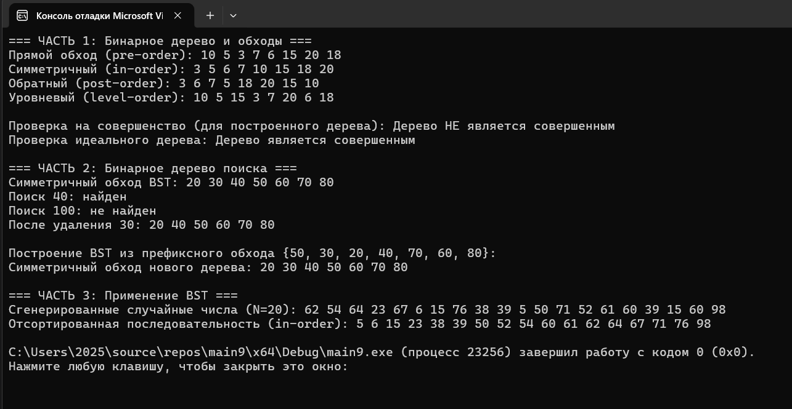

# Лабораторная работа № 9
## Бинарное дерево. Обходы. BST

**Выполнил:** _Халмышев Мансур Асланбекович_
**Группа:** __ПИЖ-б-о-25-1__
**Вариант:** 10
**Язык программирования:** C++

---

## 1. Цель работы
1. Реализовать структуру данных «бинарное дерево» и изучить способы его обхода.
2. Реализовать бинарное дерево поиска (BST) с операциями вставки, удаления и поиска.
3. Освоить применение рекурсии для работы с деревьями.
4. Проанализировать сложность операций в BST.

## 2. Постановка задачи (Вариант 10)
| Часть | Задание |
| :--- | :--- |
| **Часть 1. Бинарное дерево** | Обходы: preOrder, inOrder, postOrder, levelOrder. Доп. задание: проверить, является ли дерево совершенным. |
| **Часть 2. BST** | Операции: insert, search, inOrder, remove. Доп. задание: построение BST из префиксного обхода. |
| **Часть 3. Применение** | Создать BST из 20 случайных чисел, вывести отсортированную последовательность, найти мин/макс, высоту, удалить элемент. |

## 3. Теоретическая часть

### 3.1. Обходы дерева
*   **Прямой (pre-order):** Корень → Левое → Правое. Используется для копирования дерева.
*   **Симметричный (in-order):** Левое → Корень → Правое. Для BST выводит элементы в отсортированном порядке.
*   **Обратный (post-order):** Левое → Правое → Корень. Используется для удаления дерева.
*   **Уровневый (level-order):** По уровням сверху вниз, слева направо. Реализуется через очередь.

### 3.2. Совершенное бинарное дерево
Это дерево, в котором все внутренние узлы имеют двух потомков, а все листья находятся на одном уровне.

## 4. Листинг программы

```cpp
#include <iostream>     
#include <queue>        
#include <vector>      
#include <cstdlib>      
#include <ctime>        
#include <algorithm>    
#include <climits>      

using namespace std;   


// Структура узла бинарного дерева
struct Node {
    int data;       // Данные, хранящиеся в узле 
    Node* left;     // Указатель на левого потомка
    Node* right;    // Указатель на правого потомка

    // Конструктор узла: создает узел с заданным значением и пустыми потомками
    Node(int val) : data(val), left(nullptr), right(nullptr) {}
};

class BinaryTree {
private:
    Node* root;     // Указатель на корень дерева (верхний узел)

    // Прямой обход (Pre-order): Корень -> Лево -> Право
    void preOrder(Node* node) {
        if (node == nullptr) return; // Базовый случай: если узел пустой, выходим
        cout << node->data << " ";   // Выводим данные текущего узла
        preOrder(node->left);        // Рекурсивно обходим левое поддерево
        preOrder(node->right);       // Рекурсивно обходим правое поддерево
    }

    // Симметричный обход (In-order): Лево -> Корень -> Право
    void inOrder(Node* node) {
        if (node == nullptr) return; // Базовый случай
        inOrder(node->left);         // Сначала обходим левое поддерево
        cout << node->data << " ";   // Затем выводим корень
        inOrder(node->right);        // Затем правое поддерево
    }

    // Обратный обход (Post-order): Лево -> Право -> Корень
    void postOrder(Node* node) {
        if (node == nullptr) return; // Базовый случай
        postOrder(node->left);       // Сначала левое поддерево
        postOrder(node->right);      // Затем правое поддерево
        cout << node->data << " ";   // В конце выводим корень
    }

    // Вспомогательная функция для подсчета количества узлов (не используется в main, но полезна)
    int countNodes(Node* node) {
        if (node == nullptr) return 0; // Если узла нет, количество 0
        // 1 (текущий узел) + узлы слева + узлы справа
        return 1 + countNodes(node->left) + countNodes(node->right);
    }

    // Вспомогательная функция для проверки, является ли дерево совершенным
    bool isPerfect(Node* node, int depth, int expectedDepth) {
        if (node == nullptr) return true; // Пустое дерево считается совершенным

        // Если это лист (нет потомков), проверяем, совпадает ли его глубина с ожидаемой
        if (node->left == nullptr && node->right == nullptr) {
            return depth == expectedDepth;
        }

        // Если у узла только один потомок, дерево точно не совершенно
        if (node->left == nullptr || node->right == nullptr) {
            return false;
        }

        // Рекурсивно проверяем левое и правое поддеревья (глубина увеличивается на 1)
        return isPerfect(node->left, depth + 1, expectedDepth) &&
            isPerfect(node->right, depth + 1, expectedDepth);
    }

    // Вспомогательная функция для определения глубины (высоты) дерева
    int getDepth(Node* node) {
        if (node == nullptr) return 0; // Высота пустого дерева 0
        int leftDepth = getDepth(node->left);   // Высота левого поддерева
        int rightDepth = getDepth(node->right); // Высота правого поддерева
        // Высота дерева = 1 + максимальная из высот поддеревьев
        return max(leftDepth, rightDepth) + 1;
    }

    // Рекурсивное удаление всех узлов дерева (освобождение памяти)
    void destroy(Node* node) {
        if (node == nullptr) return;
        destroy(node->left);  // Удаляем левое поддерево
        destroy(node->right); // Удаляем правое поддерево
        delete node;          // Удаляем текущий узел
    }

public:
    // Конструктор: создает пустое дерево
    BinaryTree() : root(nullptr) {}

    // Деструктор: вызывается при уничтожении объекта
    ~BinaryTree() { destroy(root); }

    // Метод для построения тестового дерева из задания
    void buildSample() {
        root = new Node(10);                    // Корень
        root->left = new Node(5);               // Левый потомок
        root->right = new Node(15);             // Правый потомок
        root->left->left = new Node(3);         // Левый-левый
        root->left->right = new Node(7);        // Левый-правый
        root->right->right = new Node(20);      // Правый-правый
        root->left->right->left = new Node(6);  // Левый-правый-левый
        root->right->right->left = new Node(18); // Правый-правый-левый
    }

    // Метод для создания идеально сбалансированного дерева из 7 узлов
    void buildPerfect() {
        root = new Node(1);
        root->left = new Node(2);
        root->right = new Node(3);
        root->left->left = new Node(4);
        root->left->right = new Node(5);
        root->right->left = new Node(6);
        root->right->right = new Node(7);
    }

    // Публичные обертки для вызова обходов (передают корень)
    void preOrder() { preOrder(root); cout << endl; }
    void inOrder() { inOrder(root); cout << endl; }
    void postOrder() { postOrder(root); cout << endl; }

    // Уровневый обход (Level-order): обход по уровням слева направо
    void levelOrder() {
        if (root == nullptr) return; // Если дерево пусто, выходим
        queue<Node*> q;              // Создаем очередь для узлов
        q.push(root);                // Помещаем корень в очередь

        while (!q.empty()) {         // Пока очередь не пуста
            Node* current = q.front(); // Берем первый узел из очереди
            q.pop();                   // Удаляем его из очереди
            cout << current->data << " "; // Выводим его данные

            // Если есть левый потомок, добавляем в очередь
            if (current->left) q.push(current->left);
            // Если есть правый потомок, добавляем в очередь
            if (current->right) q.push(current->right);
        }
        cout << endl;
    }

    // Публичный метод для проверки на совершенство
    bool isPerfectTree() {
        int depth = getDepth(root);          // Сначала узнаем высоту дерева
        return isPerfect(root, 1, depth);    // Затем проверяем все узлы (глубина корня = 1)
    }
};


class BST {
private:
    Node* root; // Корень дерева поиска

    // Рекурсивная вставка элемента
    Node* insert(Node* node, int key) {
        if (node == nullptr) return new Node(key); // Если дошли до пустого места, создаем узел
        if (key < node->data) node->left = insert(node->left, key);   // Если меньше - идем влево
        else if (key > node->data) node->right = insert(node->right, key); // Если больше - вправо
        return node; // Возвращаем текущий узел (для сохранения структуры)
    }

    // Рекурсивный поиск элемента
    Node* search(Node* node, int key) {
        // Если узел пуст или нашли ключ, возвращаем его
        if (node == nullptr || node->data == key) return node;
        if (key < node->data) return search(node->left, key); // Ищем слева
        return search(node->right, key);                      // Ищем справа
    }

    // Поиск минимального узла в поддереве
    Node* findMin(Node* node) {
        while (node->left != nullptr) node = node->left; // Идем влево до упора
        return node;
    }

    // Рекурсивное удаление элемента
    Node* remove(Node* node, int key) {
        if (node == nullptr) return nullptr; // Элемент не найден
        if (key < node->data) node->left = remove(node->left, key);   // Ищем в левом
        else if (key > node->data) node->right = remove(node->right, key); // Ищем в правом
        else {
            // Нашли узел для удаления. Рассматриваем 3 случая:

            // Случай 1: Узел - лист (нет потомков)
            if (node->left == nullptr && node->right == nullptr) {
                delete node;
                return nullptr;
            }
            // Случай 2: Есть только правый потомок
            else if (node->left == nullptr) {
                Node* temp = node->right;
                delete node;
                return temp;
            }
            // Случай 2: Есть только левый потомок
            else if (node->right == nullptr) {
                Node* temp = node->left;
                delete node;
                return temp;
            }
            // Случай 3: Есть оба потомка
            else {
                Node* minNode = findMin(node->right);       // Ищем минимум в правом поддереве
                node->data = minNode->data;                 // Заменяем значение
                node->right = remove(node->right, minNode->data); // Удаляем дубликат
            }
        }
        return node;
    }

    // Симметричный обход для вывода отсортированного массива
    void inOrder(Node* node) {
        if (node == nullptr) return;
        inOrder(node->left);
        cout << node->data << " ";
        inOrder(node->right);
    }

    // Удаление всего дерева
    void destroy(Node* node) {
        if (node == nullptr) return;
        destroy(node->left);
        destroy(node->right);
        delete node;
    }

    // Вспомогательная функция для построения из префиксного обхода
    Node* buildFromPreOrder(vector<int>& preorder, int& index, int minVal, int maxVal) {
        if (index >= preorder.size()) return nullptr; // Дошли до конца массива

        int key = preorder[index];
        // Если текущий элемент не входит в допустимый диапазон для данного поддерева, 
        // значит, он принадлежит другому поддереву
        if (key < minVal || key > maxVal) return nullptr;

        Node* node = new Node(key); // Создаем узел
        index++; // Переходим к следующему элементу

        // Рекурсивно строим левое и правое поддеревья с обновленными границами
        node->left = buildFromPreOrder(preorder, index, minVal, key - 1);
        node->right = buildFromPreOrder(preorder, index, key + 1, maxVal);

        return node;
    }

public:
    BST() : root(nullptr) {}
    ~BST() { destroy(root); }

    void insert(int key) { root = insert(root, key); }
    bool search(int key) { return search(root, key) != nullptr; }
    void remove(int key) { root = remove(root, key); }
    void print() { inOrder(root); cout << endl; }

    // Построение BST из префиксного обхода
    void buildFromPreOrder(const vector<int>& preorder) {
        destroy(root); // Очищаем текущее дерево
        root = nullptr;
        int index = 0;
        // Вызов с максимально широкими границами
        root = buildFromPreOrder(const_cast<vector<int>&>(preorder), index, INT_MIN, INT_MAX);
    }
};


int main() {
    setlocale(LC_ALL, "ru"); // Включаем русский язык для консоли

    // --- ЧАСТЬ 1: Бинарное дерево ---
    cout << "=== ЧАСТЬ 1: Бинарное дерево и обходы ===" << endl;
    BinaryTree tree;
    tree.buildSample(); // Строим тестовое дерево

    cout << "Прямой обход (pre-order): ";
    tree.preOrder();
    cout << "Симметричный (in-order): ";
    tree.inOrder();
    cout << "Обратный (post-order): ";
    tree.postOrder();
    cout << "Уровневый (level-order): ";
    tree.levelOrder();

    // Проверка на совершенство для обычного дерева
    cout << "\nПроверка на совершенство (для построенного дерева): "
        << (tree.isPerfectTree() ? "Дерево является совершенным" : "Дерево НЕ является совершенным") << endl;

    // Проверим на идеальном дереве
    BinaryTree perfectTree;
    perfectTree.buildPerfect();
    cout << "Проверка идеального дерева: "
        << (perfectTree.isPerfectTree() ? "Дерево является совершенным" : "Дерево НЕ является совершенным") << endl << endl;


    // --- ЧАСТЬ 2: BST ---
    cout << "=== ЧАСТЬ 2: Бинарное дерево поиска ===" << endl;
    BST bst;
    bst.insert(50);
    bst.insert(30);
    bst.insert(70);
    bst.insert(20);
    bst.insert(40);
    bst.insert(60);
    bst.insert(80);

    cout << "Симметричный обход BST: ";
    bst.print();

    cout << "Поиск 40: " << (bst.search(40) ? "найден" : "не найден") << endl;
    cout << "Поиск 100: " << (bst.search(100) ? "найден" : "не найден") << endl;

    bst.remove(30); // Удаляем узел с одним потомком
    cout << "После удаления 30: ";
    bst.print();

    // Дополнительное задание: построение из префиксного обхода
    cout << "\nПостроение BST из префиксного обхода {50, 30, 20, 40, 70, 60, 80}:" << endl;
    vector<int> preorder = { 50, 30, 20, 40, 70, 60, 80 };
    BST bstFromPre;
    bstFromPre.buildFromPreOrder(preorder);
    cout << "Симметричный обход нового дерева: ";
    bstFromPre.print();


    // --- ЧАСТЬ 3: Применение ---
    cout << "\n=== ЧАСТЬ 3: Применение BST ===" << endl;
    BST appTree;
    srand(time(0)); // Инициализация генератора случайных чисел текущим временем
    cout << "Сгенерированные случайные числа (N=20): ";
    for (int i = 0; i < 20; i++) {
        int num = rand() % 100; // Генерируем число от 0 до 99
        cout << num << " ";
        appTree.insert(num);    // Вставляем в дерево
    }
    cout << endl;

    cout << "Отсортированная последовательность (in-order): ";
    appTree.print(); // In-order обход выведет числа по возрастанию

    return 0; // Успешное завершение
}
```
### 5. Результаты работы программы


## 6. Анализ сложности операций

В ходе работы были проанализированы основные операции для бинарного дерева поиска (BST). Сложность операций напрямую зависит от высоты дерева \(h\).

| Операция | Средний случай | Худший случай | Обоснование |
| :--- | :--- | :--- | :--- |
| **Поиск (search)** | \(O(\log n)\) | \(O(n)\) | В среднем дерево сбалансировано, и мы отсекаем половину ветвей на каждом шаге. В худшем случае (вырожденное дерево) поиск превращается в линейный проход по списку. |
| **Вставка (insert)** | \(O(\log n)\) | \(O(n)\) | Аналогично поиску, мы спускаемся от корня до места вставки нового листа. |
| **Удаление (remove)** | \(O(\log n)\) | \(O(n)\) | Сначала выполняется поиск узла, затем (в случае двух потомков) поиск минимума в правом поддереве. Все эти действия ограничены высотой дерева. |
| **Обходы (pre/in/post-order)** | \(O(n)\) | \(O(n)\) | Каждый узел дерева посещается ровно один раз. |
| **Уровневый обход (level-order)** | \(O(n)\) | \(O(n)\) | Каждый узел добавляется в очередь и извлекается из нее ровно один раз. |
| **Проверка на совершенство** | \(O(n)\) | \(O(n)\) | В худшем случае алгоритм должен обойти все узлы дерева, чтобы убедиться в его совершенстве. |

## 7. Ответы на контрольные вопросы

**1. Что такое бинарное дерево? Из каких элементов оно состоит?**
Бинарное дерево — это иерархическая структура данных, в которой каждый узел имеет не более двух потомков. Оно состоит из узлов (содержащих данные и указатели на потомков) и связей (ребер) между ними. Верхний узел называется корнем.

**2. В чём отличие бинарного дерева от бинарного дерева поиска (BST)?**
В обычном бинарном дереве значения могут быть расположены в любом порядке. В бинарном дереве поиска (BST) строго соблюдается правило: все значения в левом поддереве любого узла меньше самого узла, а все значения в правом поддереве — больше.

**3. Какие существуют виды обхода бинарного дерева? В чём их особенности?**
*   **Прямой (Pre-order):** Корень → Лево → Право. Используется для копирования дерева.
*   **Симметричный (In-order):** Лево → Корень → Право. Для BST выдает элементы в отсортированном порядке.
*   **Обратный (Post-order):** Лево → Право → Корень. Используется для удаления дерева (сначала удаляются дети, потом родитель).
*   **Уровневый (Level-order):** Обход по уровням сверху вниз, слева направо. Реализуется с помощью очереди.

**4. Какой обход даёт отсортированную последовательность для BST?**
Симметричный обход (In-order).

**5. Какова сложность операций поиска, вставки и удаления в BST? От чего она зависит?**
В среднем случае сложность составляет \(O(\log n)\). В худшем случае (если дерево вырождено в список) — \(O(n)\). Сложность напрямую зависит от высоты дерева, которая, в свою очередь, зависит от порядка добавления элементов.

**6. Что происходит с BST, если вставлять элементы в отсортированном порядке?**
Дерево вырождается в односвязный список. Каждый новый элемент становится либо только правым, либо только левым потомком. Высота дерева становится равной \(n\), а все операции деградируют до \(O(n)\).

**7. Какие три случая нужно рассмотреть при удалении узла из BST?**
1.  Узел является листом (нет потомков) — просто удаляем его.
2.  Узел имеет одного потомка — заменяем удаляемый узел его потомком.
3.  Узел имеет двух потомков — находим минимальный элемент в правом поддереве (или максимальный в левом), копируем его значение в удаляемый узел, а затем удаляем этот минимальный узел.

**8. Как найти наименьший элемент в BST? Наибольший?**
Наименьший: нужно спускаться от корня по левым указателям до тех пор, пока есть левый потомок.
Наибольший: нужно спускаться по правым указателям до упора.

**9. Как вычислить высоту бинарного дерева рекурсивно?**
Высота узла = 1 + максимум из высот его левого и правого поддеревьев. Для пустого узла высота равна 0.

**10. Что такое наименьший общий предок (LCA) двух узлов в дереве?**
Это самый глубокий узел, который является предком одновременно для обоих заданных узлов.

**11. Как проверить, является ли бинарное дерево BST?**
Нужно выполнить симметричный обход (In-order) и проверить, является ли полученная последовательность строго возрастающей. Либо рекурсивно проверять для каждого узла, что он больше минимально допустимого и меньше максимально допустимого значения.

**12. Что такое сбалансированное дерево? Почему это важно для производительности?**
Сбалансированное дерево — это дерево, в котором высота левого и правого поддеревьев любого узла отличается не более чем на 1. Это гарантирует, что высота дерева будет равна \(O(\log n)\), и операции поиска/вставки будут быстрыми.

**13. Как преобразовать несбалансированное BST в сбалансированное?**
Сначала нужно сделать In-order обход и сохранить все элементы в отсортированный массив. Затем нужно построить новое дерево, беря средний элемент массива как корень, и рекурсивно применяя этот алгоритм к левой и правой половинам.

**14. Как восстановить дерево по массиву обхода (in-order + pre-order)?**
Первый элемент в pre-order — это всегда корень. Находим этот элемент в in-order. Все элементы слева от него в in-order — это левое поддерево, справа — правое. Рекурсивно повторяем процесс для каждой части.

**15. Как реализовать итеративный (не рекурсивный) обход бинарного дерева?**
С помощью стека. Например, для прямого обхода (pre-order): кладем корень в стек. В цикле извлекаем узел, выводим его, затем кладем в стек сначала правого потомка, потом левого (чтобы левый обработался первым).

### 8. Вывод
В ходе работы я реализовал структуру данных бинарное дерево, изучил все основные виды обходов (включая уровневый через очередь). Также я реализовал бинарное дерево поиска (BST) с операциями вставки, поиска и удаления (разобрав все три случая). Дополнительно я реализовал проверку на совершенство дерева и алгоритм построения BST из префиксного обхода.

### 9. Ссылка на Git-репозиторий
https://github.com/mansurkhalmyshev-tech/cpp-labs.git

