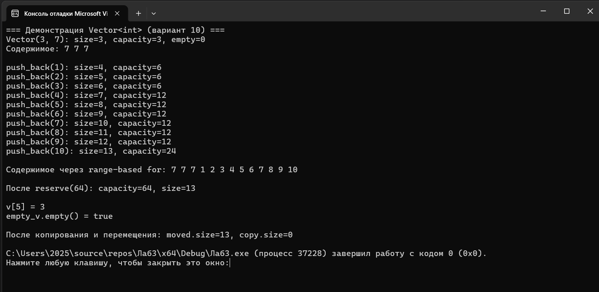

# Лабораторная работа № 3
## Реализация динамического массива (аналог vector). Итераторы

**Выполнил:** _Халмышев Мансур Асланбекович_
**Группа:** __ПИЖ-б-о-25-1__
**Вариант:** 10 (Средний уровень)
**Язык программирования:** C++

---

## 1. Цель работы
1. Реализовать шаблонный класс `Vector<T>` — аналог `std::vector` — с нуля.
2. Освоить управление динамической памятью: выделение, расширение, освобождение.
3. Закрепить «правило трёх» и освоить «правило пяти» (конструкторы и операторы перемещения).
4. Реализовать итераторы для поддержки range-based for и STL-совместимости.
5. Провести амортизированный анализ операции `push_back`.

## 2. Постановка задачи (Вариант 10)
Реализовать шаблонный класс `Vector` со следующими компонентами:
*   **Конструкторы:** по умолчанию; с параметрами (размер, значение).
*   **Обязательные методы:** `push_back`, `size`, `empty`, `reserve`.
*   **Средний уровень:** реализовать «Правило пяти» (деструктор, конструктор копирования, оператор присваивания копированием, конструктор перемещения, оператор присваивания перемещением) и итераторы (`begin`, `end`).

## 3. Теоретическая часть

### 3.1. Правило пяти
Поскольку класс управляет динамической памятью, необходимо явно определить 5 специальных методов:
1.  **Деструктор** — освобождает память (`delete[] data`).
2.  **Конструктор копирования** — создает глубокую копию (выделяет новую память и копирует элементы).
3.  **Оператор присваивания копированием** — освобождает старую память и копирует новую (с защитой от самоприсваивания).
4.  **Конструктор перемещения** — «забирает» ресурсы у временного объекта (перекидывает указатель), оставляя временный объект в безопасном состоянии (nullptr).
5.  **Оператор присваивания перемещением** — аналогично освобождает свои ресурсы и забирает чужие.

### 3.2. Амортизированный анализ `push_back`
При добавлении элемента, если емкость (`cap`) исчерпана, массив расширяется в 2 раза (стратегия удвоения). 
Копирование элементов происходит только при расширении. Суммарное количество копирований при \(n\) вставках составляет около \(2n\). Следовательно, в среднем на одну операцию `push_back` приходится \(O(1)\) действий (амортизированная сложность).

## 4. Листинг программы

```cpp
#include <iostream>  
#include <stdexcept> 
#include <utility> 
#include <algorithm> 
#include <clocale>   
#include <iomanip>   
#include <string>    

using namespace std;

template <typename T>
class Vector {        // объявление класса Vector
private:              // Приватная секция 
    T* data;          // Указатель на первый элемент динамического массива в памяти
    int sz;           // Текущий размер вектора 
    int cap;          // Ёмкость вектора 

public:

    Vector() : data(nullptr), sz(0), cap(0) {} // Конструктор по умолчанию. Инициализирует пустой вектор 


    explicit Vector(int n) : data(nullptr), sz(n), cap(n) { // Конструктор, создающий вектор размера n.
        if (n < 0) throw std::invalid_argument("negative size"); // Проверка на отрицательный размер. 
        if (n > 0) { // Если размер больше нуля
            data = new T[cap]; // Выделяем память в куче под cap элементов типа T
            for (int i = 0; i < sz; ++i) data[i] = T(); // Заполняем массив значениями по умолчанию 
        }
    }


    Vector(int n, const T& val) : data(nullptr), sz(n), cap(n) { // Конструктор, создающий вектор  и заполняющий его значением 
        if (n < 0) throw std::invalid_argument("negative size"); // Проверка на отрицательный размер
        if (n > 0) { // Если размер больше нуля
            data = new T[cap]; // Выделяем память
            for (int i = 0; i < sz; ++i) data[i] = val; // Заполняем все ячейки значением val
        }
    }


    Vector(const Vector& other) : data(nullptr), sz(other.sz), cap(other.cap) { // Конструктор копирования 
        if (cap > 0) { // Если у копируемого вектора есть выделенная память
            data = new T[cap]; // Выделяем новую память для текущего объекта 
            for (int i = 0; i < sz; ++i) data[i] = other.data[i]; // Копируем каждый элемент из other в текущий объект
        }
    }


    Vector(Vector&& other) noexcept // Конструктор перемещения
        : data(other.data), sz(other.sz), cap(other.cap) { // Просто копируем указатели и размеры к текущему объекту
        other.data = nullptr; // Обнуляем указатель у source-объекта
        other.sz = 0; // Обнуляем размер source-объекта
        other.cap = 0; // Обнуляем ёмкость source-объекта
    }


    ~Vector() { delete[] data; } // Деструктор. Освобождает память чтобы не было утечек


    Vector& operator=(const Vector& other) { // Оператор присваивания копированием 
        if (this != &other) { // Защита от самоприсваивания 
            Vector temp(other); // Создаем временную копию правого операнда
            swap(temp); // Меняем содержимое текущего объекта с временным 
        }
        return *this; // Возвращаем ссылку на текущий объект для цепочек присваивания 
    }


    Vector& operator=(Vector&& other) noexcept { // Оператор присваивания перемещением
        if (this != &other) { // Защита от самоприсваивания
            delete[] data; // Освобождаем старую память текущего объекта
            data = other.data; // Забираем указатель у other
            sz = other.sz; // Копируем размер
            cap = other.cap; // Копируем ёмкость
            other.data = nullptr; // Обнуляем указатель other
            other.sz = 0; // Обнуляем размер other
            other.cap = 0; // Обнуляем ёмкость other
        }
        return *this;
    }


    void swap(Vector& other) noexcept { // Метод для обмена содержимым двух векторов
        std::swap(data, other.data); // Меняем местами указатели
        std::swap(sz, other.sz); // Меняем местами размеры
        std::swap(cap, other.cap); // Меняем местами ёмкости
    }


    T& operator[](int index) { // Оператор доступа по индексу 
        if (index < 0 || index >= sz) // Проверка выхода за границы
            throw std::out_of_range("Index out of range"); // Выбрасываем исключение, если индекс неверный
        return data[index]; // Возвращаем ссылку на элемент 
    }
    const T& operator[](int index) const { // Оператор доступа по индексу 
        if (index < 0 || index >= sz) // Проверка выхода за границы
            throw std::out_of_range("Index out of range"); // Выбрасываем исключение
        return data[index]; // Возвращаем константную ссылку на элемент 
    }


    int  size()     const { return sz; } // Возвращает текущий размер вектора
    int  capacity() const { return cap; } // Возвращает текущую ёмкость вектора
    bool empty()    const { return sz == 0; } // Возвращает true, если вектор пуст 


    void reserve(int newCap) { // Метод для резервирования памяти под newCap элементов
        if (newCap <= cap) return; // Если запрошено меньше или столько же, сколько уже есть — ничего не делаем
        T* newData = new T[newCap]; // Выделяем новый блок памяти большего размера
        for (int i = 0; i < sz; ++i) newData[i] = data[i]; // Копируем старые элементы в новую память
        delete[] data; // Освобождаем старую память
        data = newData; // Перенаправляем указатель на новую память
        cap = newCap; // Обновляем значение ёмкости
    }


    void push_back(const T& value) { // Метод добавления элемента в конец
        if (sz >= cap) { // Если места больше нет 
            int newCap = (cap == 0) ? 1 : cap * 2; // Вычисляем новую ёмкость:
            reserve(newCap); // Резервируем новую память 
        } // Конец if
        data[sz++] = value; // Записываем новый элемент в конец и увеличиваем размер на 1
    }


    void pop_back() { // Метод удаления последнего элемента
        if (empty()) throw std::underflow_error("Vector is empty"); // Если вектор пуст, выбрасываем исключение
        --sz; // Просто уменьшаем размер на 1 
    }


    void resize(int newSize, const T& defaultValue = T()) { // Метод изменения размера вектора
        if (newSize < 0) throw std::invalid_argument("negative size"); // Проверка на отрицательный размер
        if (newSize < sz) { // Если новый размер меньше текущего
            sz = newSize; // Просто обрезаем размер 
        }
        else if (newSize > sz) { // Если новый размер больше текущего
            if (newSize > cap) reserve(newSize); // Если не хватает ёмкости — резервируем 
            for (int i = sz; i < newSize; ++i) data[i] = defaultValue; // Заполняем новые ячейки значением по умолчанию
            sz = newSize; // Обновляем размер
        }
    }


    void clear() { sz = 0; } // Метод очистки вектора. 


    T* begin() { return data; } // Возвращает указатель на первый элемент 
    T* end() { return data + sz; } // Возвращает указатель на элемент, следующий за последним 
    const T* begin() const { return data; } // Константная версия begin() 
    const T* end()   const { return data + sz; } // Константная версия end() 
};


int main() { // Главная функция, с которой начинается выполнение программы
    setlocale(LC_ALL, "ru"); // Устанавливаем русскую локаль для корректного отображения кириллицы в консоли

    cout << "=== Демонстрация Vector<int> (вариант 10) ===\n";


    Vector<int> v(3, 7); // Создаем вектор из 3 элементов типа int, заполненный значением 7
    cout << "Vector(3, 7): size=" << v.size() // Выводим размер (3)
        << ", capacity=" << v.capacity() << ", empty=" << v.empty() << "\n"; // Выводим ёмкость (3) и проверку на пустоту
    cout << "Содержимое: "; // Выводим текст
    for (int x : v) cout << x << " "; // перебираем все элементы вектора v и выводим их (7 7 7)
    cout << "\n\n"; // Переход на новую строку


    for (int i = 1; i <= 10; ++i) { // Цикл от 1 до 10
        v.push_back(i); // Добавляем число i в конец вектора
        cout << "push_back(" << i << "): size=" << v.size() // Выводим, что добавили
            << ", capacity=" << v.capacity() << "\n"; // Выводим новый размер и ёмкость
    }

    cout << "\nСодержимое через range-based for: ";
    for (int x : v) cout << x << " "; // Перебираем и выводим все элементы вектора 
    cout << "\n\n";


    v.reserve(64); // Принудительно выделяем память под 64 элемента
    cout << "После reserve(64): capacity=" << v.capacity() // Выводим новую ёмкость (64)
        << ", size=" << v.size() << "\n\n"; // Выводим размер 


    cout << "v[5] = " << v[5] << "\n"; // Выводим элемент с индексом 5 


    Vector<int> empty_v; // Создаем пустой вектор
    cout << "empty_v.empty() = " << (empty_v.empty() ? "true" : "false") << "\n\n"; // Проверяем, пуст ли он 


    Vector<int> copy = v; // Создаем копию вектора v 
    Vector<int> moved = std::move(copy); // Перемещаем данные из copy в moved
    cout << "После копирования и перемещения: moved.size=" << moved.size() // Выводим размер moved 
        << ", copy.size=" << copy.size() << "\n"; // Выводим размер copy 

    return 0;
}
```
### 5. Результаты работы программы
При запуске программа демонстрирует работу всех требуемых методов, включая «Правило пяти» и итераторы.



### 1. Анализ сложности операций
Операция	Сложность	Обоснование
size(), empty()	O(1)	Возвращают значение переменной sz.
operator[]	O(1)	Прямой доступ к элементу по индексу в массиве.
push_back()	Амортизированно O(1)	В худшем случае (при расширении) — O(n) из-за копирования. В среднем — O(1).
reserve()	O(n)	Требуется выделить новый массив и скопировать в него sz элементов.
Копирование (Copy)	O(n)	Выделение памяти и поэлементное копирование n элементов.
Перемещение (Move)	O(1)	Происходит только перекидывание указателей, без копирования данных.

## Ответы на контрольные вопросы 
1. Что такое динамический массив?
Это структура данных, память под которую выделяется в куче (heap) во время выполнения программы, а не на этапе компиляции. Его размер можно изменять (увеличивать или уменьшать) по мере необходимости.

2. В чём разница между size и capacity?
size — это количество элементов, которые сейчас реально находятся в массиве. capacity — это максимальное количество элементов, которое можно поместить в уже выделенную память без нового перевыделения.

3. Что такое «Правило пяти»?
Это правило C++, гласящее, что если классу требуется пользовательский деструктор, конструктор копирования или оператор присваивания копированием (Правило трех), то ему, вероятно, также нужны конструктор перемещения и оператор присваивания перемещением (для эффективного управления ресурсами).

4. Зачем нужен конструктор перемещения?
Он позволяет избежать дорогостоящего глубокого копирования, «забирая» ресурсы (например, указатель на массив) у временного объекта. Это работает за O(1) вместо O(n).

5. Как работает амортизированный анализ?
Это метод оценки, который усредняет стоимость операции в худшем случае на длинной последовательности операций. Например, push_back иногда занимает O(n) времени, но если усреднить по множеству вызовов, то на одну операцию приходится O(1).

### Вывод
В ходе лабораторной работы я реализовал шаблонный класс Vector, который повторяет логику std::vector. Были изучены механизмы выделения и освобождения динамической памяти, а также важность реализации «Правила пяти» для предотвращения утечек памяти и двойного удаления. Реализованы итераторы для удобного перебора элементов.

### Ссылка на Git-репозиторий
https://github.com/mansurkhalmyshev-tech/Lab3-ACD.git